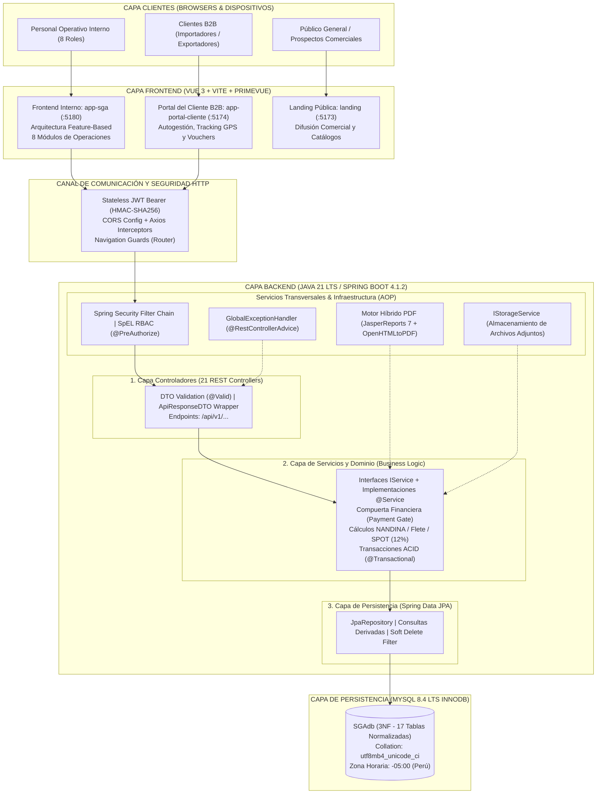

# Arquitectura de Software y Patrones de Diseño
### Sistema de Gestión Aduanera - Transaduanas (SGA)

---

## 📋 Índice del Documento

1. [Visión General de la Arquitectura](#1-visión-general-de-la-arquitectura)
2. [Diagrama Maestro de Arquitectura del Ecosistema](#2-diagrama-maestro-de-arquitectura-del-ecosistema)
3. [Pilares Arquitectónicos Fundamentales](#3-pilares-arquitectónicos-fundamentales)
   - [3.1 Desacoplamiento Front-to-Back (Arquitectura Headless)](#31-desacoplamiento-front-to-back-arquitectura-headless)
   - [3.2 Ecosistema Frontend Multi-SPA (Feature-Based Architecture)](#32-ecosistema-frontend-multi-spa-feature-based-architecture)
   - [3.3 Backend Monolítico Modular en Capas (N-Tier Architecture)](#33-backend-monolítico-modular-en-capas-n-tier-architecture)
   - [3.4 Modelo de Datos Relacional Normalizado (3NF) y Persistencia ACID](#34-modelo-de-datos-relacional-normalizado-3nf-y-persistencia-acid)
   - [3.5 Seguridad Stateless y Control de Acceso Basado en Roles (RBAC)](#35-seguridad-stateless-y-control-de-acceso-basado-en-roles-rbac)
4. [Catálogo de Patrones de Diseño Implementados](#4-catálogo-de-patrones-de-diseño-implementados)
   - [4.1 Patrones Creacionales (Creational Patterns)](#41-patrones-creacionales-creational-patterns)
   - [4.2 Patrones Estructurales (Structural Patterns)](#42-patrones-estructurales-structural-patterns)
   - [4.3 Patrones de Comportamiento (Behavioral Patterns)](#43-patrones-de-comportamiento-behavioral-patterns)
   - [4.4 Patrones Arquitectónicos y Empresariales (Enterprise & Architectural Patterns)](#44-patrones-arquitectónicos-y-empresariales-enterprise--architectural-patterns)
5. [Matriz de Trazabilidad entre Patrones y Componentes](#5-matriz-de-trazabilidad-entre-patrones-y-componentes)

---

## 1. Visión General de la Arquitectura

El **Sistema de Gestión Aduanera - Transaduanas** adopta un estilo arquitectónico **Cliente-Servidor Desacoplado (Headless)** basado en **Múltiples Single Page Applications (Multi-SPA)** que consumen una **API RESTful Monolítica Modular orientada a Dominio (N-Tier Modular Monolith)**.

Esta arquitectura fue seleccionada estratégicamente para resolver los desafíos de negocio del comercio exterior peruano:
- **Alta segregación de perfiles:** Separación estricta entre las operaciones internas de los 8 roles institucionales y el autoservicio de clientes corporativos (B2B).
- **Inmutabilidad y auditoría fiscal:** Cumplimiento con la normativa de SUNAT que exige preservar expedientes y comprobantes durante un mínimo de 5 años mediante *Soft Delete*.
- **Compuertas financieras infranqueables:** Bloqueo automatizado de operaciones aduaneras previas a la validación de anticipos contables.
- **Rendimiento y escalabilidad:** Autenticación totalmente *Stateless* con JWT Bearer sin almacenamiento de sesiones en memoria del servidor.

---

## 2. Diagrama Maestro de Arquitectura del Ecosistema



---

## 3. Pilares Arquitectónicos Fundamentales

### 3.1 Desacoplamiento Front-to-Back (Arquitectura Headless)
- El backend Java Spring Boot actúa de forma **100% agnóstica de la interfaz de usuario**, exponiendo exclusivamente una **API RESTful Stateless**.
- Todas las interacciones de datos viajan serializadas en formato JSON estructurado mediante contratos estrictos (`RequestDTO` y `ResponseDTO`).
- Las descargas de documentos oficiales (cotizaciones, certificados VGM, reportes y facturas) se gestionan como *streams* de datos binarios en formato PDF (`application/pdf`).

### 3.2 Ecosistema Frontend Multi-SPA (Feature-Based Architecture)
En lugar de un único frontend monolítico sobrecargado, el sistema divide la experiencia de usuario en **tres SPAs independientes**:
1. **Frontend Interno SGA ([`app-sga/`](file:///Users/jiodev/Documents/Proyects/SGA-transaduanas/app-sga), Puerto `5180`):**
   - Diseñado para los **8 roles institucionales**.
   - **Estructura Modular por Características (*Feature-Based*):**
     - Módulos funcionales verticales: `admin`, `comercial`, `aduanas`, `almacen`, `transporte`, `finanzas`, `liquidacion`, `legal`.
     - Núcleo horizontal: `apiClient` (instancia de Axios con interceptores que inyectan el token JWT y capturan respuestas HTTP 401 para redirección automática), Pinia stores (`authStore`, `navigationStore`) y `router.beforeEach` para validación de rutas y roles.
   - **Sistema de Diseño *Warm Editorial*:** Diseño corporativo personalizado sin dependencias de frameworks CSS pesados (Vanilla CSS con tokens en variables CSS), soporte para Modo Claro / Modo Oscuro y adaptación del preset *Aura* de PrimeVue.
2. **Portal del Cliente B2B ([`app-portal-cliente/`](file:///Users/jiodev/Documents/Proyects/SGA-transaduanas/app-portal-cliente), Puerto `5174`):**
   - Plataforma de autoservicio para empresas importadoras y exportadoras.
   - Autenticación directa mediante RUC de 11 dígitos.
   - Consulta de deudas consolidadas (`/api/v1/portal/obligaciones-pendientes`), seguimiento GPS de camiones, descarga de DAMs y subida de vouchers de pago.
3. **Landing Page Pública ([`landing/`](file:///Users/jiodev/Documents/Proyects/SGA-transaduanas/landing), Puerto `5173`):**
   - SPA ligera e independiente orientada a marketing, captación de prospectos y punto de acceso al ecosistema.

### 3.3 Backend Monolítico Modular en Capas (N-Tier Architecture)
El backend implementa una arquitectura multicapa tradicional de grado empresarial con estricta separación de responsabilidades unidireccional:
- **Capa de Controladores (Presentación):** 21 controladores REST (`pe.sga.controller`). Validan la estructura de las peticiones mediante Jakarta Validation (`@Valid`), aplican restricciones de seguridad con SpEL (`@PreAuthorize`) y delegan la ejecución a los servicios, retornando siempre el envoltorio unificado `ApiResponseDTO<T>`.
- **Capa de Servicios (Dominio y Lógica de Negocio):** Ubicada en `pe.sga.service` e implementada en `pe.sga.service.impl`. Concentra las reglas de negocio (cálculo de aranceles NANDINA, fletes, verificación de la compuerta financiera, liquidación con detracción SPOT 12%) y orquesta las transacciones ACID mediante `@Transactional`.
- **Capa de Repositorios (Acceso a Datos):** Ubicada en `pe.sga.repository`. Utiliza Spring Data JPA para abstraer las consultas SQL hacia MySQL.
- **Servicios Transversales (*Cross-Cutting Concerns*):** Interceptores de seguridad, manejo centralizado de excepciones con AOP (`@RestControllerAdvice`), almacenamiento de archivos físicos multipart y motor híbrido de reportería PDF (JasperReports 7 + OpenHTMLtoPDF/Thymeleaf).

### 3.4 Modelo de Datos Relacional Normalizado (3NF) y Persistencia ACID
- **Motor:** MySQL 8.4 LTS InnoDB (`SGAdb`).
- **Normalización:** 17 tablas relacionales en Tercera Forma Normal (3NF) que aseguran integridad referencial total, eliminando anomalías de inserción, actualización o borrado.
- **Tolerancia Cero a Borrado Físico (*Soft Delete Pattern*):** Con el objetivo de cumplir con la normativa aduanera de SUNAT (custodia mínima de 5 años para fiscalización posterior), ninguna entidad operativa se elimina mediante sentencias SQL `DELETE`. El sistema implementa banderas booleanas (`estado_activo = false`) o transiciones a estados terminales (`ANULADO`, `CANCELADO`, `INACTIVO`).

### 3.5 Seguridad Stateless y Control de Acceso Basado en Roles (RBAC)
- **Autenticación Stateless:** El servidor no guarda sesiones HTTP en memoria (`SessionCreationPolicy.STATELESS`). Cada petición viaja con una cabecera `Authorization: Bearer <token>` firmada criptográficamente con HMAC-SHA256 (`jjwt-api 0.13.0`).
- **Matriz de 8 Roles Institucionales:** Centralizada en la clase [`SecurityRoles.java`](file:///Users/jiodev/Documents/Proyects/SGA-transaduanas/backend/src/main/java/pe/sga/config/SecurityRoles.java) para evaluación SpEL antes de ejecutar cualquier método del backend:
  1. `ADMINISTRADOR_TI`: Gobierno integral de la plataforma, roles, sedes y logs.
  2. `GERENTE_GENERAL`: Visualización global de métricas y supervisión ejecutiva.
  3. `AGENTE_COMERCIAL`: Registro de prospectos y calculadora de cotizaciones de 4 pasos.
  4. `SUPERVISOR_ADUANERO`: Apertura de expedientes y tramitación telemática de DAM SUNAT.
  5. `AGENTE_ADUANERO`: Operaciones en depósito temporal y báscula certificada VGM.
  6. `SUPERVISOR_TRANSPORTE`: Asignación de tractos, choferes MTC y tracking en ruta.
  7. `CONTADOR`: Validación obligatoria de anticipos pre-expediente y liquidaciones SPOT.
  8. `ASESOR_LEGAL`: Auditoría normativa y permisos sectoriales (MTC, SENASA, DIGEMID).

---

## 4. Catálogo de Patrones de Diseño Implementados

### 4.1 Patrones Creacionales (*Creational Patterns*)

#### 1. Builder Pattern (Constructor Fluido)
- **Ubicación en el Código:** Utilizado masivamente a través de la anotación `@Builder` de Lombok en Entidades JPA (`Cotizacion`, `Expediente`, `Cliente`, `DespachoTransporte`) y en clases DTO ([`ApiResponseDTO.java`](file:///Users/jiodev/Documents/Proyects/SGA-transaduanas/backend/src/main/java/pe/sga/dto/response/ApiResponseDTO.java), [`ClienteResponseDTO.java`](file:///Users/jiodev/Documents/Proyects/SGA-transaduanas/backend/src/main/java/pe/sga/dto/response/ClienteResponseDTO.java)).
- **Propósito y Justificación:** Permite construir instancias de objetos con más de 20 atributos opcionales sin necesidad de recurrir a constructores telescópicos propensos a errores de orden en los argumentos.

```java
// Ejemplo en ClienteServiceImpl.java:
ClienteResponseDTO dto = ClienteResponseDTO.builder()
        .idCliente(c.getIdCliente())
        .razonSocial(c.getRazonSocial())
        .numeroDocumento(c.getNumeroDocumento())
        .estadoCliente(c.getEstadoCliente())
        .estadoActivo(c.getEstadoActivo())
        .build();
```

#### 2. Static Factory Method (Método de Fábrica Estático)
- **Ubicación en el Código:** Métodos estáticos semánticos en [`ApiResponseDTO.java`](file:///Users/jiodev/Documents/Proyects/SGA-transaduanas/backend/src/main/java/pe/sga/dto/response/ApiResponseDTO.java).
- **Propósito y Justificación:** Encapsula y simplifica la creación de respuestas exitosas o fallidas, proporcionando una API limpia y expresiva para los 21 controladores REST.

```java
// Métodos estáticos de fábrica en ApiResponseDTO.java:
public static <T> ApiResponseDTO<T> ok(String message, T data) { ... }
public static <T> ApiResponseDTO<T> ok(T data) { ... }
public static <T> ApiResponseDTO<T> error(String message) { ... }
```

#### 3. Singleton Pattern (Instancia Única)
- **Ubicación en el Código:** Motor de inyección de dependencias de Spring Boot (Anotaciones `@Service`, `@RestController`, `@Component`, `@Configuration`).
- **Propósito y Justificación:** Garantiza que cada servicio, controlador y configuración exista como una única instancia compartida dentro del contenedor de Spring (`ApplicationContext`), optimizando el uso de memoria RAM y el ciclo de vida de los componentes.

---

### 4.2 Patrones Estructurales (*Structural Patterns*)

#### 1. Data Transfer Object (DTO)
- **Ubicación en el Código:** Paquetes [`pe.sga.dto.request`](file:///Users/jiodev/Documents/Proyects/SGA-transaduanas/backend/src/main/java/pe/sga/dto/request), [`pe.sga.dto.response`](file:///Users/jiodev/Documents/Proyects/SGA-transaduanas/backend/src/main/java/pe/sga/dto/response) y [`pe.sga.dto.portal`](file:///Users/jiodev/Documents/Proyects/SGA-transaduanas/backend/src/main/java/pe/sga/dto/portal).
- **Propósito y Justificación:** Desacopla completamente las tablas y entidades JPA de la capa REST. Evita ataques de asignación masiva (*Mass Assignment*), reduce el payload de red transfiriendo solo los campos necesarios y permite validar contratos de entrada mediante anotaciones Jakarta (`@NotBlank`, `@Positive`, `@Size`).

#### 2. Wrapper / Response Envelope (Envoltorio de Respuesta Unificada)
- **Ubicación en el Código:** Clase genérica [`ApiResponseDTO<T>`](file:///Users/jiodev/Documents/Proyects/SGA-transaduanas/backend/src/main/java/pe/sga/dto/response/ApiResponseDTO.java).
- **Propósito y Justificación:** Estandariza el 100% de los retornos HTTP de la API, garantizando que los frontends siempre reciban un JSON con las propiedades: `success` (boolean), `message` (string), `data` (T genérico) y `timestamp` (fecha/hora).

```json
{
  "success": true,
  "message": "Cotización generada con éxito",
  "data": {
    "codigoCotizacion": "COT-2026-00088",
    "totalCotizado": 116247.65
  },
  "timestamp": "2026-10-29T13:25:00"
}
```

#### 3. Adapter / Mapper Pattern
- **Ubicación en el Código:** Métodos privados `mapToResponse` y `mapToEntity` implementados en cada clase de servicio (ej. `ClienteServiceImpl`, `CotizacionServiceImpl`).
- **Propósito y Justificación:** Actúa como adaptador entre el modelo orientado a objetos del dominio y los DTOs de transporte, aislando las entidades JPA de modificaciones externas.

#### 4. Facade Pattern (Fachada)
- **Ubicación en el Código:** Capa de servicios (`ICotizacionService`, `IExpedienteService`, `IPortalService`).
- **Propósito y Justificación:** Proporciona interfaces simplificadas que ocultan la alta complejidad interna del dominio aduanero (consultas cruzadas a múltiples repositorios, cálculos arancelarios, validaciones financieras y guardado de archivos adjuntos).

#### 5. Dynamic Proxy (Proxy Dinámico AOP)
- **Ubicación en el Código:** Infraestructura interna de Spring Framework:
  - `@Transactional`: Proxy que intercepta la ejecución para iniciar, confirmar (*commit*) o revertir (*rollback*) transacciones en MySQL.
  - `@PreAuthorize`: Proxy de seguridad que intercepta las llamadas a los controladores para evaluar los privilegios del token JWT.
  - Spring Data JPA: Genera automáticamente en tiempo de ejecución las implementaciones de las interfaces `JpaRepository`.

---

### 4.3 Patrones de Comportamiento (*Behavioral Patterns*)

#### 1. Strategy Pattern (Estrategia)
- **Ubicación en el Código:**
  - Interfaz [`IStorageService`](file:///Users/jiodev/Documents/Proyects/SGA-transaduanas/backend/src/main/java/pe/sga/service/IStorageService.java) e implementación concreta [`LocalStorageServiceImpl`](file:///Users/jiodev/Documents/Proyects/SGA-transaduanas/backend/src/main/java/pe/sga/service/impl/LocalStorageServiceImpl.java).
  - Servicio de reportes [`ReporteJasperServiceImpl`](file:///Users/jiodev/Documents/Proyects/SGA-transaduanas/backend/src/main/java/pe/sga/service/impl/ReporteJasperServiceImpl.java).
- **Propósito y Justificación:** Desacopla la estrategia concreta de almacenamiento físico de archivos. Actualmente almacena en el sistema de archivos local, pero puede conmutarse a Amazon S3 o Google Cloud Storage implementando la interfaz `IStorageService` sin alterar el código de los servicios que consumen documentos. Asimismo, el motor de reportes alterna la estrategia de renderizado entre JasperReports nativo y plantillas Thymeleaf con OpenHTMLtoPDF según el tipo de documento.

#### 2. Chain of Responsibility (Cadena de Responsabilidad)
- **Ubicación en el Código:** Cadena de filtros de seguridad en [`SecurityConfig.java`](file:///Users/jiodev/Documents/Proyects/SGA-transaduanas/backend/src/main/java/pe/sga/config/SecurityConfig.java) (`SecurityFilterChain`).
- **Propósito y Justificación:** Las peticiones HTTP atraviesan una serie ordenada de filtros (CORS ➔ CSRF ➔ Gestión de Sesión ➔ Filtro JWT ➔ Autorización de Métodos). Cada filtro realiza su labor y delega la ejecución al siguiente eslabón mediante `filterChain.doFilter(request, response)`.

#### 3. Interceptor / Filter Pattern
- **Ubicación en el Código:** Clase [`JwtAuthenticationFilter.java`](file:///Users/jiodev/Documents/Proyects/SGA-transaduanas/backend/src/main/java/pe/sga/config/JwtAuthenticationFilter.java) que extiende de `OncePerRequestFilter`.
- **Propósito y Justificación:** Intercepta cada petición entrante una única vez, extrae el token Bearer de la cabecera `Authorization`, valida su firma criptográfica HMAC-SHA256 y puebla el contexto de seguridad con el usuario y rol correspondiente.

#### 4. Template Method (Método Plantilla)
- **Ubicación en el Código:** `OncePerRequestFilter.doFilterInternal()` en Spring Security y el motor de plantillas `SpringTemplateEngine` / Thymeleaf en [`ReporteJasperServiceImpl.java`](file:///Users/jiodev/Documents/Proyects/SGA-transaduanas/backend/src/main/java/pe/sga/service/impl/ReporteJasperServiceImpl.java).
- **Propósito y Justificación:** Define el flujo invariable de un algoritmo (ciclo de vida de la petición HTTP o ciclo de compilación del documento PDF), permitiendo que las clases o plantillas personalicen únicamente los pasos específicos (parámetros y datos dinámicos).

#### 5. Command / Startup Hook
- **Ubicación en el Código:** [`DataInitializer.java`](file:///Users/jiodev/Documents/Proyects/SGA-transaduanas/backend/src/main/java/pe/sga/config/DataInitializer.java) implementando `CommandLineRunner`.
- **Propósito y Justificación:** Encapsula la orden de verificar e inicializar catálogos maestros y credenciales iniciales en una rutina ejecutable automáticamente al completarse el arranque del servidor.

---

### 4.4 Patrones Arquitectónicos y Empresariales (*Enterprise & Architectural Patterns*)

#### 1. Layered Architecture (N-Tier / Arquitectura en Capas)
- **Ubicación en el Código:** La división física de paquetes Java:
  - `pe.sga.controller` (Presentación)
  - `pe.sga.service` / `pe.sga.service.impl` (Dominio)
  - `pe.sga.repository` (Persistencia)
  - `pe.sga.entity` (Modelo Relacional)
- **Propósito y Justificación:** Garantiza alta cohesión interna y bajo acoplamiento entre capas; ninguna capa conoce los detalles de implementación de la inferior.

#### 2. Inversion of Control (IoC) & Dependency Injection (DI)
- **Ubicación en el Código:** Utilización generalizada de inyección de dependencias por constructor asistida por `@RequiredArgsConstructor` de Lombok en controladores y servicios.
- **Propósito y Justificación:** Cumple con el Principio de Inversión de Dependencias (DIP) de SOLID: los controladores dependen de interfaces abstractas (`ICotizacionService`, `IClienteService`) y no de implementaciones concretas, permitiendo el reemplazo y testeo unitario exhaustivo con mocks (`Mockito`).

#### 3. Repository Pattern (Repositorio)
- **Ubicación en el Código:** Paquete [`pe.sga.repository`](file:///Users/jiodev/Documents/Proyects/SGA-transaduanas/backend/src/main/java/pe/sga/repository) (`JpaRepository<T, ID>`).
- **Propósito y Justificación:** Encapsula el almacenamiento, recuperación y búsqueda de datos en MySQL como si fuese una colección en memoria, proveyendo métodos estándar (`save`, `findById`, `findAll`) y consultas derivadas (`findByEstadoActivo`, `existsByCotizacion...`).

#### 4. Data Mapper Pattern (ORM)
- **Ubicación en el Código:** Hibernate ORM sobre el paquete [`pe.sga.entity`](file:///Users/jiodev/Documents/Proyects/SGA-transaduanas/backend/src/main/java/pe/sga/entity).
- **Propósito y Justificación:** Mantiene la independencia absoluta entre el esquema relacional de la base de datos (17 tablas en MySQL) y el modelo de objetos en memoria de Java.

#### 5. Global Exception Handler / Front Controller Exception Handling (AOP)
- **Ubicación en el Código:** [`GlobalExceptionHandler.java`](file:///Users/jiodev/Documents/Proyects/SGA-transaduanas/backend/src/main/java/pe/sga/exception/GlobalExceptionHandler.java) con `@RestControllerAdvice` y `@ExceptionHandler`.
- **Propósito y Justificación:** Aplica Programación Orientada a Aspectos (AOP) para interceptar de manera transversal todas las excepciones del backend (`ResourceNotFoundException`, `BadRequestException`, `AccessDeniedException`, fallos de validación `@Valid`). Oculta los *stack traces* internos del servidor y retorna respuestas semánticas con códigos HTTP precisos (400, 401, 403, 404, 500).

#### 6. Gatekeeper / Guard Pattern (Compuerta de Negocio)
- **Ubicación en el Código:** Compuerta Financiera Pre-Expediente en [`ExpedienteServiceImpl.java`](file:///Users/jiodev/Documents/Proyects/SGA-transaduanas/backend/src/main/java/pe/sga/service/impl/ExpedienteServiceImpl.java).
- **Propósito y Justificación:** Regla de negocio crítica que actúa como centinela infranqueable: antes de permitir la inserción de un expediente aduanero, verifica que la cotización asociada cuente con un abono bancario formalmente registrado y en estado `VALIDADO` por el área contable. Si no se cumple la condición, bloquea la operación y lanza una excepción de negocio (`BadRequestException`).

```java
// Implementación del Guard Pattern en ExpedienteServiceImpl.java:
boolean tienePagoValidado = cotizacionPagoRepository
    .existsByCotizacion_IdCotizacionAndEstadoPago(cotizacion.getIdCotizacion(), EstadoPago.VALIDADO);

if (!tienePagoValidado) {
    throw new BadRequestException("COMPUERTA FINANCIERA BLOQUEADA: La cotización " 
        + cotizacion.getCodigoCotizacion() 
        + " no cuenta con un pago validado por Finanzas/Contador. Trámite no autorizado.");
}
```

#### 7. Soft Delete Pattern (Borrado Lógico)
- **Ubicación en el Código:** Columna booleana `estado_activo` en entidades y repositorios con filtros derivados (`findByEstadoActivo(true)`).
- **Propósito y Justificación:** Prohíbe la ejecución de sentencias SQL `DELETE` en la base de datos, realizando en su lugar sentencias `UPDATE tabla SET estado_activo = false`. Esto preserva la inmutabilidad histórica requerida por las auditorías de SUNAT durante 5 años.

---

## 5. Matriz de Trazabilidad entre Patrones y Componentes

| Patrón de Diseño | Clasificación | Componente Principal en el SGA | Archivo de Referencia |
| :--- | :--- | :--- | :--- |
| **Builder** | Creacional | Entidades JPA y DTOs | [`ApiResponseDTO.java`](file:///Users/jiodev/Documents/Proyects/SGA-transaduanas/backend/src/main/java/pe/sga/dto/response/ApiResponseDTO.java) |
| **Static Factory Method** | Creacional | Respuesta estándar API REST | [`ApiResponseDTO.java`](file:///Users/jiodev/Documents/Proyects/SGA-transaduanas/backend/src/main/java/pe/sga/dto/response/ApiResponseDTO.java) |
| **Singleton** | Creacional | Gestión de Beans IoC | Contenedor Spring Boot |
| **Data Transfer Object** | Estructural | Contratos Request y Response | [`pe.sga.dto.*`](file:///Users/jiodev/Documents/Proyects/SGA-transaduanas/backend/src/main/java/pe/sga/dto) |
| **Wrapper / Envelope** | Estructural | Envoltorio HTTP universal | [`ApiResponseDTO.java`](file:///Users/jiodev/Documents/Proyects/SGA-transaduanas/backend/src/main/java/pe/sga/dto/response/ApiResponseDTO.java) |
| **Adapter / Mapper** | Estructural | Transformación DTO ⟷ Entity | [`ClienteServiceImpl.java`](file:///Users/jiodev/Documents/Proyects/SGA-transaduanas/backend/src/main/java/pe/sga/service/impl/ClienteServiceImpl.java) |
| **Facade** | Estructural | Capa de Servicios | [`pe.sga.service.impl.*`](file:///Users/jiodev/Documents/Proyects/SGA-transaduanas/backend/src/main/java/pe/sga/service/impl) |
| **Dynamic Proxy** | Estructural | `@Transactional` y `@PreAuthorize` | Spring Framework AOP |
| **Strategy** | Comportamiento | Almacén de Archivos y Reportes | [`IStorageService.java`](file:///Users/jiodev/Documents/Proyects/SGA-transaduanas/backend/src/main/java/pe/sga/service/IStorageService.java) |
| **Chain of Responsibility** | Comportamiento | Cadena de Filtros HTTP | [`SecurityConfig.java`](file:///Users/jiodev/Documents/Proyects/SGA-transaduanas/backend/src/main/java/pe/sga/config/SecurityConfig.java) |
| **Interceptor / Filter** | Comportamiento | Autenticación JWT Bearer | [`JwtAuthenticationFilter.java`](file:///Users/jiodev/Documents/Proyects/SGA-transaduanas/backend/src/main/java/pe/sga/config/JwtAuthenticationFilter.java) |
| **Template Method** | Comportamiento | Motor de Plantillas Thymeleaf | [`ReporteJasperServiceImpl.java`](file:///Users/jiodev/Documents/Proyects/SGA-transaduanas/backend/src/main/java/pe/sga/service/impl/ReporteJasperServiceImpl.java) |
| **Command / Startup** | Comportamiento | Semilla y Catálogos Iniciales | [`DataInitializer.java`](file:///Users/jiodev/Documents/Proyects/SGA-transaduanas/backend/src/main/java/pe/sga/config/DataInitializer.java) |
| **Layered Architecture** | Arquitectónico | Diseño N-Tier | Arquitectura global `pe.sga.*` |
| **IoC & Dependency Injection**| Arquitectónico | Inyección por constructor | `@RequiredArgsConstructor` (Lombok) |
| **Repository Pattern** | Arquitectónico | Capa de Acceso a Datos | [`pe.sga.repository.*`](file:///Users/jiodev/Documents/Proyects/SGA-transaduanas/backend/src/main/java/pe/sga/repository) |
| **Data Mapper (ORM)** | Arquitectónico | Persistencia Relacional | Hibernate / JPA |
| **Global Exception Handler** | Arquitectónico | Captura de Errores con AOP | [`GlobalExceptionHandler.java`](file:///Users/jiodev/Documents/Proyects/SGA-transaduanas/backend/src/main/java/pe/sga/exception/GlobalExceptionHandler.java) |
| **Gatekeeper / Guard** | Arquitectónico | Compuerta Financiera | [`ExpedienteServiceImpl.java`](file:///Users/jiodev/Documents/Proyects/SGA-transaduanas/backend/src/main/java/pe/sga/service/impl/ExpedienteServiceImpl.java) |
| **Soft Delete** | Arquitectónico | Preservación de Auditoría Fiscal | Entidades con `estado_activo` |
