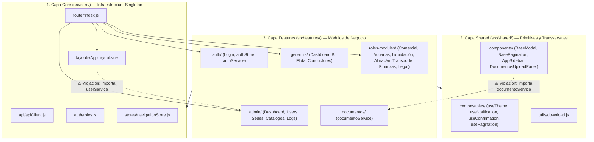
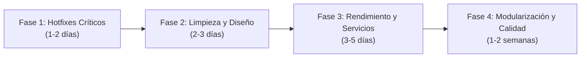

# Informe de Arquitectura de Software, Patrones de Diseño, Revisión de Componentes y Plan de Optimización (Front-End)

**Proyecto:** TransAduanas Platform — Sistema ERP de Gestión Aduanera y Logística Internacional  
**Alcance del Análisis:** Capa Front-End (`frontend/`) y su alineación con la documentación oficial ([`README.md`](file:///home/jiodev/Documents/Proyects/TransAduanas%20Platform/README.md), [`docs/frontend.md`](file:///home/jiodev/Documents/Proyects/TransAduanas%20Platform/docs/frontend.md), [`docs/lenguaje_diseño.md`](file:///home/jiodev/Documents/Proyects/TransAduanas%20Platform/docs/lenguaje_diseño.md) y [`docs/backend.md`](file:///home/jiodev/Documents/Proyects/TransAduanas%20Platform/docs/backend.md)).  
**Stack Tecnológico Auditado:** Vue 3.5.30 (Composition API + `<script setup>`), Vite 8.0.0, PrimeVue 4.5.4 (`@primeuix/themes` Aura Preset), Tailwind CSS v4.2.2, Pinia 3.0.4, Vue Router 5.0.3, Axios 1.13.6, Lucide Vue Next 1.7.0.  
**Volumen Auditado:** 72 archivos de código fuente en `frontend/` (~44,215 líneas de código).

---

## Tabla de Contenidos

1. [Resumen Ejecutivo y Estado Actual](#1-resumen-ejecutivo-y-estado-actual)
2. [Análisis de la Arquitectura de Software](#2-análisis-de-la-arquitectura-de-software)
3. [Análisis de Patrones de Diseño y Anti-Patrones](#3-análisis-de-patrones-de-diseño-y-anti-patrones)
4. [Hallazgos Críticos y Bugs Funcionales Detectados](#4-hallazgos-críticos-y-bugs-funcionales-detectados)
5. [Auditoría de Cumplimiento del Sistema de Diseño (`lenguaje_diseño.md`)](#5-auditoría-de-cumplimiento-del-sistema-de-diseño-lenguaje_diseñomd)
6. [Revisión Detallada por Complemento, Capa y Módulo](#6-revisión-detallada-por-complemento-capa-y-módulo)
7. [Catálogo de Optimizaciones de Código Propuestas](#7-catálogo-de-optimizaciones-de-código-propuestas)
8. [Hoja de Ruta de Implementación de Mejoras (Roadmap)](#8-hoja-de-ruta-de-implementación-de-mejoras-roadmap)

---

## 1. Resumen Ejecutivo y Estado Actual

El Front-End de **TransAduanas Platform** presenta una base visual sólida, con un sistema de diseño propio bien conceptualizado (**"Warm Alabaster & Espresso Gold"** documentado en [`docs/lenguaje_diseño.md`](file:///home/jiodev/Documents/Proyects/TransAduanas%20Platform/docs/lenguaje_diseño.md)), soporte nativo para modo claro/oscuro, control de acceso basado en 9 roles (RBAC) y cobertura funcional para todo el flujo operativo aduanero (Comercial, Aduanas, Liquidación, Almacén, Transporte, Finanzas, Legal, Gerencia y Administración).

Sin embargo, el crecimiento acelerado de los módulos operativos ha introducido **deuda técnica estructural, cuellos de botella de red ($N+1$ peticiones HTTP simultáneas), componentes monolíticos ("God Components" de hasta 4,392 líneas) y bugs funcionales críticos** que impiden completar ciertos flujos en producción.

### Indicadores Clave de Salud del Código (KPIs de Auditoría)

| Dimensión | Estado | Calificación | Observación Principal |
| :--- | :---: | :---: | :--- |
| **Arquitectura de Carpetas** | ⚠️ Parcial | **7.0 / 10** | Estructura híbrida `core` / `shared` / `features`, pero `roles-modules/` concentra 7 dominios distintos (29 archivos, >24,000 LOC) en una sola carpeta. |
| **Patrones de Diseño** | ⚠️ Parcial | **6.5 / 10** | Buen uso de Interceptors, Setup Stores y Composables, pero coexisten 3 mecanismos redundantes para cambiar pestañas (`query`, `Pinia` y `window.dispatchEvent`). |
| **Modularidad y Tamaño de Componentes** | 🔴 Crítico | **4.5 / 10** | 16 archivos superan las 1,000 líneas. [`FinanzasView.vue`](file:///home/jiodev/Documents/Proyects/TransAduanas%20Platform/frontend/src/features/roles-modules/views/FinanzasView.vue) tiene **4,392 líneas** y [`CotizacionRegistrationForm.vue`](file:///home/jiodev/Documents/Proyects/TransAduanas%20Platform/frontend/src/features/roles-modules/components/CotizacionRegistrationForm.vue) tiene **3,611 líneas**. |
| **Rendimiento de Red (API)** | 🔴 Crítico | **4.0 / 10** | Cascadas $N+1$ severas en [`FinanzasView.vue`](file:///home/jiodev/Documents/Proyects/TransAduanas%20Platform/frontend/src/features/roles-modules/views/FinanzasView.vue#L2116-L2158), [`RecepcionComercialView.vue`](file:///home/jiodev/Documents/Proyects/TransAduanas%20Platform/frontend/src/features/roles-modules/views/RecepcionComercialView.vue#L985-L1005), [`GestionAduaneraView.vue`](file:///home/jiodev/Documents/Proyects/TransAduanas%20Platform/frontend/src/features/roles-modules/views/GestionAduaneraView.vue#L928-L945) y [`GerenciaDashboardView.vue`](file:///home/jiodev/Documents/Proyects/TransAduanas%20Platform/frontend/src/features/gerencia/views/GerenciaDashboardView.vue#L410-L426). |
| **Reutilización de Estilos (CSS)** | 🔴 Crítico | **4.0 / 10** | ~18,000 líneas de CSS (`>40%` del repositorio) son bloques `<style scoped>` duplicados entre vistas (`.hero-banner-card`, `.kpi-card`, `.form-block-card`). |
| **Calidad Funcional y Contratos DTO** | 🔴 Crítico | **5.0 / 10** | 7 bugs funcionales críticos (asignación de recursos rota, eliminación de documentos/plantillas rota, botones bloqueados tras error, desajustes de campos DTO). |
| **Tipado, Linting y Testing** | 🔴 Crítico | **3.0 / 10** | Sin TypeScript/JSDoc, sin ESLint/Prettier configurados en [`package.json`](file:///home/jiodev/Documents/Proyects/TransAduanas%20Platform/frontend/package.json), y 0 pruebas unitarias/E2E (Vitest/Playwright). |

---

## 2. Análisis de la Arquitectura de Software

### 2.1 Topología Actual de Capas

El proyecto implementa una **Arquitectura Modular por Capas y Dominios (Feature-Sliced / Screaming Architecture Híbrida)** organizada en tres niveles dentro de `frontend/src/`:



### 2.2 Desviaciones Arquitectónicas Identificadas

1. **Concentración Monolítica en `src/features/roles-modules/`**:
   - Mientras que `auth`, `admin` y `gerencia` tienen carpetas dedicadas, **siete módulos empresariales completos** (Recepción Comercial, Gestión Aduanera, Liquidación Aduanera, Agente Aduanero/Almacén, Transporte y Flota, Finanzas y Legal/Auditoría) están mezclados dentro de `src/features/roles-modules/`.
   - Esta carpeta acumula **29 archivos y más de 24,000 líneas de código**, rompiendo la cohesión por dominio y dificultando el mantenimiento independiente por rol.

2. **Asimetría en `src/features/admin/`**:
   - El archivo de rutas de todo el módulo administrador está ubicado en [`src/features/admin/users/routes/admin.routes.js`](file:///home/jiodev/Documents/Proyects/TransAduanas%20Platform/frontend/src/features/admin/users/routes/admin.routes.js) (dentro de `users/`) a pesar de declarar las rutas de `dashboard`, `sedes`, `catalogos`, `logs` y `acerca-de`.
   - [`SystemLogsView.vue`](file:///home/jiodev/Documents/Proyects/TransAduanas%20Platform/frontend/src/features/admin/views/SystemLogsView.vue) y [`logsService.js`](file:///home/jiodev/Documents/Proyects/TransAduanas%20Platform/frontend/src/features/admin/services/logsService.js) cuelgan directamente de `admin/views/` y `admin/services/`, mientras que los demás submódulos tienen su propia subcarpeta (`admin/users/`, `admin/sedes/`, `admin/catalogos/`, `admin/dashboard/`).

3. **Inversión de Dependencias entre Capas (`core` $\rightarrow$ `features` y `shared` $\rightarrow$ `features`)**:
   - En una arquitectura limpia, las dependencias deben fluir unidireccionalmente: `features` $\rightarrow$ `shared` $\rightarrow$ `core`.
   - **Violación 1**: [`src/core/layouts/AppLayout.vue`](file:///home/jiodev/Documents/Proyects/TransAduanas%20Platform/frontend/src/core/layouts/AppLayout.vue#L269) importa `userService` desde `@/features/admin/users/services/userService.js` para editar el perfil del usuario actual.
   - **Violación 2**: [`src/shared/components/DocumentosUploadPanel.vue`](file:///home/jiodev/Documents/Proyects/TransAduanas%20Platform/frontend/src/shared/components/DocumentosUploadPanel.vue#L459) importa `documentoService` desde `@/features/documentos/services/documentoService.js`.
   - **Violación 3**: [`src/shared/components/AppSidebar.vue`](file:///home/jiodev/Documents/Proyects/TransAduanas%20Platform/frontend/src/shared/components/AppSidebar.vue#L198-L383) conoce y codifica de forma rígida (hardcoded) las pestañas internas y nombres de eventos DOM de 10 vistas distintas de `features/`.

---

## 3. Análisis de Patrones de Diseño y Anti-Patrones

### 3.1 Patrones de Diseño Correctamente Implementados

| Patrón de Diseño | Ubicación en el Código | Evaluación |
| :--- | :--- | :--- |
| **Singleton HTTP Client + Interceptor** | [`src/core/api/apiClient.js`](file:///home/jiodev/Documents/Proyects/TransAduanas%20Platform/frontend/src/core/api/apiClient.js#L1-L50) | Excelente centralización de `baseURL`, timeout de 15s, inyección automática de `Authorization: Bearer <JWT>` y manejo global de expiración (`401`). |
| **Composition Store (Pinia Setup Store)** | [`src/features/auth/stores/authStore.js`](file:///home/jiodev/Documents/Proyects/TransAduanas%20Platform/frontend/src/features/auth/stores/authStore.js), [`src/core/stores/navigationStore.js`](file:///home/jiodev/Documents/Proyects/TransAduanas%20Platform/frontend/src/core/stores/navigationStore.js) | Uso limpio de `ref()` para estado, `computed()` para getters derivados y funciones para acciones asíncronas. |
| **Adapter / Facade via Composables** | [`useNotification.js`](file:///home/jiodev/Documents/Proyects/TransAduanas%20Platform/frontend/src/shared/composables/useNotification.js), [`useConfirmation.js`](file:///home/jiodev/Documents/Proyects/TransAduanas%20Platform/frontend/src/shared/composables/useConfirmation.js), [`useTheme.js`](file:///home/jiodev/Documents/Proyects/TransAduanas%20Platform/frontend/src/shared/composables/useTheme.js) | Desacopla las vistas de la API imperativa de PrimeVue (`useToast`, `useConfirm`) y del DOM (`classList.toggle('dark')`). |
| **Declarative Role-Based Guard (RBAC)** | [`src/core/router/index.js`](file:///home/jiodev/Documents/Proyects/TransAduanas%20Platform/frontend/src/core/router/index.js#L65-L128) y [`src/core/auth/roles.js`](file:///home/jiodev/Documents/Proyects/TransAduanas%20Platform/frontend/src/core/auth/roles.js) | Guard global `router.beforeEach` declarativo guiado por `to.meta.roles` y mapa de rutas iniciales `ROLE_HOME_ROUTES`. |
| **Lazy Route Code-Splitting** | `*.routes.js` en `auth`, `admin`, `gerencia`, `roles-modules` | Todas las rutas de vistas utilizan importaciones dinámicas `() => import(...)`, evitando cargar todos los módulos en el arranque inicial. |
| **Master-Detail Inline Full-Canvas** | Vistas de Usuarios, Sedes, Catálogos, Comercial y Finanzas | Reemplazo condicional del listado por un lienzo completo de registro (`v-if="showForm"`), evitando modales estrechos para formularios complejos. |

### 3.2 Anti-Patrones y "Code Smells" Detectados

#### 1. Anti-Patrón "Triple Bus de Eventos" para Navegación de Sub-Pestañas
Para cambiar de pestaña dentro de una vista desde el menú lateral ([`AppSidebar.vue`](file:///home/jiodev/Documents/Proyects/TransAduanas%20Platform/frontend/src/shared/components/AppSidebar.vue#L299-L383)), el código ejecuta **tres mecanismos distintos al mismo tiempo**:
1. Modifica el store global: `navigationStore.setActiveTab(subItem.id)`
2. Navega por Vue Router con query params: `router.push({ path: ..., query: { tab: subItem.id } })`
3. Dispara eventos globales en `window`: `window.dispatchEvent(new CustomEvent('recepcion-tab-change', { detail: subItem.id }))` (y equivalentes `'aduanas-tab-change'`, `'liquidacion-tab-change'`, `'almacen-tab-change'`, `'transporte-tab-change'`, `'finanzas-tab-change'`, `'legal-tab-change'`, `'gerencia-tab-change'`, `'catalogos-tab-change'`, `'admin-action'`).

A su vez, cada vista registra un `window.addEventListener(...)` en `onMounted`, un `window.removeEventListener(...)` en `onUnmounted`, y un `watch(() => route.query.tab)`. Esto es redundante y propenso a desincronización: **basta únicamente con observar `route.query.tab` en Vue Router**.

#### 2. Anti-Patrón "God Component" (Componentes Monolíticos)
Existen 16 componentes que superan las 1,000 líneas al mezclar múltiples sub-vistas, modales inline, lógica de negocio financiera/aduanera, validaciones manuales y miles de líneas de CSS:
- [`FinanzasView.vue`](file:///home/jiodev/Documents/Proyects/TransAduanas%20Platform/frontend/src/features/roles-modules/views/FinanzasView.vue): **4,392 líneas** (5 pestañas completas + generador de comprobantes + modales + 1,760 líneas de CSS).
- [`CotizacionRegistrationForm.vue`](file:///home/jiodev/Documents/Proyects/TransAduanas%20Platform/frontend/src/features/roles-modules/components/CotizacionRegistrationForm.vue): **3,611 líneas** (Wizard de 4 pasos + motor de cálculo CIF/flete/seguro + modal rápido de clientes + 1,680 líneas de CSS).
- [`RegistroPagoFullView.vue`](file:///home/jiodev/Documents/Proyects/TransAduanas%20Platform/frontend/src/features/roles-modules/components/RegistroPagoFullView.vue): **2,334 líneas**.
- [`RecepcionComercialView.vue`](file:///home/jiodev/Documents/Proyects/TransAduanas%20Platform/frontend/src/features/roles-modules/views/RecepcionComercialView.vue): **2,166 líneas**.
- [`GestionAduaneraView.vue`](file:///home/jiodev/Documents/Proyects/TransAduanas%20Platform/frontend/src/features/roles-modules/views/GestionAduaneraView.vue): **2,026 líneas**.
- [`TransporteFlotaView.vue`](file:///home/jiodev/Documents/Proyects/TransAduanas%20Platform/frontend/src/features/roles-modules/views/TransporteFlotaView.vue): **1,972 líneas**.
- [`UserRegistrationForm.vue`](file:///home/jiodev/Documents/Proyects/TransAduanas%20Platform/frontend/src/features/admin/users/components/UserRegistrationForm.vue): **1,863 líneas**.
- [`CatalogosManagementView.vue`](file:///home/jiodev/Documents/Proyects/TransAduanas%20Platform/frontend/src/features/admin/catalogos/views/CatalogosManagementView.vue): **1,711 líneas**.

#### 3. Anti-Patrón de Servicios Duplicados y Desempaquetado Inconsistente
- **Triplicación de endpoints de Expedientes**: Los mismos endpoints REST (`/api/v1/expedientes`) están definidos en tres archivos distintos:
  1. [`src/features/roles-modules/services/expedienteService.js`](file:///home/jiodev/Documents/Proyects/TransAduanas%20Platform/frontend/src/features/roles-modules/services/expedienteService.js)
  2. [`src/features/roles-modules/services/gestionAduaneraService.js`](file:///home/jiodev/Documents/Proyects/TransAduanas%20Platform/frontend/src/features/roles-modules/services/gestionAduaneraService.js)
  3. [`src/features/roles-modules/services/comercialService.js`](file:///home/jiodev/Documents/Proyects/TransAduanas%20Platform/frontend/src/features/roles-modules/services/comercialService.js#L89-L121)
- **Duplicación de endpoints de Pagos**: Definidos tanto en [`finanzasService.js`](file:///home/jiodev/Documents/Proyects/TransAduanas%20Platform/frontend/src/features/roles-modules/services/finanzasService.js) como en [`comercialService.js`](file:///home/jiodev/Documents/Proyects/TransAduanas%20Platform/frontend/src/features/roles-modules/services/comercialService.js#L68-L86).
- **Duplicación de endpoints de Mercancías**: Definidos tanto en [`catalogoService.js`](file:///home/jiodev/Documents/Proyects/TransAduanas%20Platform/frontend/src/features/admin/catalogos/services/catalogoService.js#L73-L99) como en [`mercanciaService.js`](file:///home/jiodev/Documents/Proyects/TransAduanas%20Platform/frontend/src/features/admin/catalogos/services/mercanciaService.js).
- **Inconsistencia en retorno de `ApiResponse<T>`**: En [`catalogoService.js`](file:///home/jiodev/Documents/Proyects/TransAduanas%20Platform/frontend/src/features/admin/catalogos/services/catalogoService.js), `getPuertos()` (línea 11) retorna `response.data` (el envoltorio `{ success, message, data }`), mientras que `getMercancias()` (línea 75) retorna `response.data.data` (el arreglo directo). Esto obliga a todas las vistas a escribir código defensivo como `res?.data?.content || res?.data || res || []`.

---

## 4. Hallazgos Críticos y Bugs Funcionales Detectados

A continuación se detallan los **8 bugs funcionales de severidad alta/crítica** encontrados durante la inspección estática del código, con rutas exactas y números de línea:

### 🔴 Bug #1: Fallo Total al Asignar Recursos a un Despacho (`undefined` en URL)
- **Archivo:** [`src/features/roles-modules/components/AsignarRecursosModal.vue`](file:///home/jiodev/Documents/Proyects/TransAduanas%20Platform/frontend/src/features/roles-modules/components/AsignarRecursosModal.vue#L164) (líneas `16` y `164`) y [`ConfirmarEntregaModal.vue`](file:///home/jiodev/Documents/Proyects/TransAduanas%20Platform/frontend/src/features/roles-modules/components/ConfirmarEntregaModal.vue#L16) (línea `16`).
- **Causa:** En `submitForm()` (línea 164) se invoca:
  ```js
  await transporteFlotaService.asignarRecursos(props.despacho.idDespacho, payload)
  ```
  Sin embargo, el DTO del backend `DespachoTransporteResponse` nombra al identificador `idDespachoTransporte` (tal como se usa correctamente en [`ConfirmarEntregaModal.vue`](file:///home/jiodev/Documents/Proyects/TransAduanas%20Platform/frontend/src/features/roles-modules/components/ConfirmarEntregaModal.vue#L188) y [`TransporteFlotaView.vue`](file:///home/jiodev/Documents/Proyects/TransAduanas%20Platform/frontend/src/features/roles-modules/views/TransporteFlotaView.vue#L396)).
- **Impacto:** `props.despacho.idDespacho` es `undefined`. Al enviar el formulario se realiza un `PATCH /api/v1/transporte/despachos/undefined/asignar-recursos`, provocando un error HTTP `400 Bad Request` siempre. Además, en la línea 16 de ambos modales se interpola `{{ despacho.numeroTracking }}` en lugar de `{{ despacho.codigoTracking }}`.

### 🔴 Bug #2: Imposibilidad de Eliminar Documentos y Plantillas de Checklist
- **Archivos:**
  - [`src/shared/components/DocumentosUploadPanel.vue`](file:///home/jiodev/Documents/Proyects/TransAduanas%20Platform/frontend/src/shared/components/DocumentosUploadPanel.vue#L581-L585) (`handleDelete`, líneas `581–585`)
  - [`src/features/roles-modules/views/GestionAduaneraView.vue`](file:///home/jiodev/Documents/Proyects/TransAduanas%20Platform/frontend/src/features/roles-modules/views/GestionAduaneraView.vue#L1132-L1135) (`confirmarEliminarPlantilla`, líneas `1132–1135`)
  - [`src/shared/composables/useConfirmation.js`](file:///home/jiodev/Documents/Proyects/TransAduanas%20Platform/frontend/src/shared/composables/useConfirmation.js#L13-L46) (`confirmAction`, líneas `13–46`)
- **Causa:** `useConfirmation.js` define `confirmAction(options)` esperando un objeto `{ message, header, onAccept, ... }` y **no devuelve una Promesa** (`returns undefined`). Sin embargo, tanto `DocumentosUploadPanel.vue` como `GestionAduaneraView.vue` lo llaman pasando dos strings posicionales y esperando un booleano con `await`:
  ```js
  const confirmed = await confirmAction(
    `¿Estás seguro de eliminar el documento "${doc.nombreOriginal}"?...`,
    'Eliminar Documento'
  )
  if (!confirmed) return
  ```
- **Impacto:** `options.message` resulta `undefined`, `confirmAction` retorna `undefined` inmediatamente, `if (!confirmed) return` aborta la función en el acto y **ningún documento ni plantilla de checklist puede ser eliminado en toda la plataforma**.

### 🔴 Bug #3: Bloqueo Permanente de Botones (`submitting = true`) cuando Falla el Guardado en el Padre
- **Archivos afectados:**
  1. [`UserRegistrationForm.vue`](file:///home/jiodev/Documents/Proyects/TransAduanas%20Platform/frontend/src/features/admin/users/components/UserRegistrationForm.vue#L825) (línea `825`)
  2. [`SedeRegistrationForm.vue`](file:///home/jiodev/Documents/Proyects/TransAduanas%20Platform/frontend/src/features/admin/sedes/components/SedeRegistrationForm.vue#L521) (línea `521`)
  3. [`PuertoRegistrationForm.vue`](file:///home/jiodev/Documents/Proyects/TransAduanas%20Platform/frontend/src/features/admin/catalogos/components/PuertoRegistrationForm.vue#L445) (línea `445`)
  4. [`TipoCargaRegistrationForm.vue`](file:///home/jiodev/Documents/Proyects/TransAduanas%20Platform/frontend/src/features/admin/catalogos/components/TipoCargaRegistrationForm.vue#L571) (línea `571`)
  5. [`ClienteRegistrationForm.vue`](file:///home/jiodev/Documents/Proyects/TransAduanas%20Platform/frontend/src/features/roles-modules/components/ClienteRegistrationForm.vue#L474) (línea `474`)
  6. [`CotizacionRegistrationForm.vue`](file:///home/jiodev/Documents/Proyects/TransAduanas%20Platform/frontend/src/features/roles-modules/components/CotizacionRegistrationForm.vue#L1556) (línea `1556`)
- **Causa:** Los formularios hijos asignan `submitting.value = true` justo antes de hacer `emit('saved', payload)` (o `emit('submit', payload)`). Como `emit` en Vue no espera promesas del componente padre ni resetea `submitting.value = false`, si el backend devuelve un error (ej. RUC duplicado, email ya registrado, error 400/409), la vista padre muestra el toast de error y mantiene el formulario abierto para que el usuario corrija el dato, pero **el botón de "Guardar" queda permanentemente deshabilitado en estado "Guardando..."** obligando a recargar el navegador.

### 🔴 Bug #4: Estado de Salud del Backend Siempre en `true` en el Dashboard Admin
- **Archivo:** [`src/features/admin/dashboard/views/AdminDashboardView.vue`](file:///home/jiodev/Documents/Proyects/TransAduanas%20Platform/frontend/src/features/admin/dashboard/views/AdminDashboardView.vue#L428-L433) (líneas `428–433`).
- **Causa:**
  ```js
  if (healthRes.status === 'fulfilled' && healthRes.value?.data) {
    isBackendHealthy.value = true
  } else {
    isBackendHealthy.value = true // <-- Bug: asigna true también cuando falla
  }
  ```
- **Impacto:** Aunque el endpoint `/actuator/health` falle o el servidor caiga, el panel de administración reporta falsamente que la API está `"En línea"`.

### 🔴 Bug #5: Pérdida Silenciosa de Datos en `TipoCargaRegistrationForm.vue`
- **Archivo:** [`src/features/admin/catalogos/components/TipoCargaRegistrationForm.vue`](file:///home/jiodev/Documents/Proyects/TransAduanas%20Platform/frontend/src/features/admin/catalogos/components/TipoCargaRegistrationForm.vue#L573-L577) (líneas `180–286` y `573–577`).
- **Causa:** El formulario presenta la sección **"02. Especificaciones Logísticas y Contenedorización"** donde el usuario captura `form.tipoContenedorSugerido` y `form.taraSugeridaKg`. Sin embargo, al construir el `payload` en `handleSubmit()` (líneas 573–577), solo se envían `nombre`, `descripcion` y `requierecadenaFrio`, descartando silenciosamente los datos de contenedor y tara.

### 🔴 Bug #6: Filtrado Local sobre Página Única del Servidor en Gestión de Usuarios
- **Archivo:** [`src/features/admin/users/views/UserManagementView.vue`](file:///home/jiodev/Documents/Proyects/TransAduanas%20Platform/frontend/src/features/admin/users/views/UserManagementView.vue#L206-L234) (líneas `206–234` y `240–271`).
- **Causa:** `loadUsers()` pide al backend únicamente una página de 10 registros (`userService.getAll(pagination.currentPage.value, pagination.pageSize.value)`), pero los filtros de búsqueda (`searchQuery`), rol (`selectedRole`) y estado (`selectedStatus`) se aplican en memoria (`filteredUsers` computed) **solo sobre esos 10 usuarios de la página actual**.
- **Impacto:** Si un administrador busca un usuario que se encuentra en la página 2 mientras está en la página 1, la tabla muestra `"No se encontraron usuarios"`. Además, los contadores de tarjetas KPI (`activeUsersCount`, `inactiveUsersCount`, líneas 226–234) cuentan solo los activos de la página de 10 elementos y no del total de usuarios.

### 🔴 Bug #7: Desajustes de Nombres de Propiedades DTO en Vistas Operativas y Gerenciales
1. **[`GerenciaDashboardView.vue`](file:///home/jiodev/Documents/Proyects/TransAduanas%20Platform/frontend/src/features/gerencia/views/GerenciaDashboardView.vue#L160) (líneas `160`, `449–450`)**:
   - Renderiza `{{ s.nombreSede }}` cuando `SedeResponse` devuelve `s.nombre` (mostrando texto vacío).
   - Filtra puertos usando `p.tipoPuerto === 'MARITIMO'` y `'AEREO'` cuando `PuertoResponse` usa `p.tipo`, provocando que los indicadores `puertosMaritimos` y `puertosAereos` muestren siempre `0`.
2. **[`RecepcionComercialView.vue`](file:///home/jiodev/Documents/Proyects/TransAduanas%20Platform/frontend/src/features/roles-modules/views/RecepcionComercialView.vue#L722) (líneas `722` y `1059`)**:
   - Busca y renderiza `exp.numeroDeclaracion`, mientras que el DTO `ExpedienteAduaneroResponse` del backend utiliza `exp.numeroDam`.
3. **[`AuditoriaExpedienteModal.vue`](file:///home/jiodev/Documents/Proyects/TransAduanas%20Platform/frontend/src/features/roles-modules/components/AuditoriaExpedienteModal.vue#L381) (líneas `381`, `387` y `485`)**:
   - Lee `cotizacion.costoTransporteRuta` en lugar de `cotizacion.costoTransporteInterno`, mostrando siempre `\$0.00` en el rubro de transporte interno durante la auditoría legal.

### 🔴 Bug #8: Funcionalidades Simuladas en Memoria sin Persistencia Real en Backend
1. **[`LiquidacionAduaneraView.vue`](file:///home/jiodev/Documents/Proyects/TransAduanas%20Platform/frontend/src/features/roles-modules/views/LiquidacionAduaneraView.vue#L665-L671) (`guardarEnExpediente`, líneas `665–671`)**:
   - El botón **"Guardar en Expediente"** muestra un mensaje Toast de éxito (`showSuccess(...)`) pero **no realiza ninguna llamada HTTP a ningún servicio**. Al recargar la página, la liquidación calculada desaparece.
2. **[`LegalAuditoriaView.vue`](file:///home/jiodev/Documents/Proyects/TransAduanas%20Platform/frontend/src/features/roles-modules/views/LegalAuditoriaView.vue#L494-L515) (`recursosList` líneas `494–515`, `guardarRecurso` líneas `577–594`)**:
   - La pestaña de **"Recursos y Reclamos SUNAT"** opera sobre un `ref` estático con 3 expedientes ficticios hardcodeados y `guardarRecurso` solo ejecuta `recursosList.value.unshift(...)` en la memoria RAM del navegador.

---

## 5. Auditoría de Cumplimiento del Sistema de Diseño (`lenguaje_diseño.md`)

Se contrastó el código fuente con las reglas obligatorias establecidas en [`docs/lenguaje_diseño.md`](file:///home/jiodev/Documents/Proyects/TransAduanas%20Platform/docs/lenguaje_diseño.md):

| Regla en `docs/lenguaje_diseño.md` | Estado | Archivos que Incumplen la Norma |
| :--- | :---: | :--- |
| **Sección 6.6: Principio Anti-Duplicidad (Un Solo Lugar por Acción)**<br>*"Los botones Guardar y Cancelar viven única y exclusivamente en el Header Sticky Superior. Queda prohibido repetir bloques de botones al final de la columna derecha del sidebar."* | ❌ Incumplido en 5 formularios | 1. [`UserRegistrationForm.vue`](file:///home/jiodev/Documents/Proyects/TransAduanas%20Platform/frontend/src/features/admin/users/components/UserRegistrationForm.vue#L606-L627) (líneas `606–627`)<br>2. [`SedeRegistrationForm.vue`](file:///home/jiodev/Documents/Proyects/TransAduanas%20Platform/frontend/src/features/admin/sedes/components/SedeRegistrationForm.vue#L361-L380) (líneas `361–380`)<br>3. [`PuertoRegistrationForm.vue`](file:///home/jiodev/Documents/Proyects/TransAduanas%20Platform/frontend/src/features/admin/catalogos/components/PuertoRegistrationForm.vue#L325-L344) (líneas `325–344`)<br>4. [`TipoCargaRegistrationForm.vue`](file:///home/jiodev/Documents/Proyects/TransAduanas%20Platform/frontend/src/features/admin/catalogos/components/TipoCargaRegistrationForm.vue#L412-L432) (líneas `412–432`)<br>5. [`RegistroPagoFullView.vue`](file:///home/jiodev/Documents/Proyects/TransAduanas%20Platform/frontend/src/features/roles-modules/components/RegistroPagoFullView.vue#L769-L790) (líneas `769–790`) |
| **Sección 4.1: Prohibición de Restricciones Artificiales `max-width`**<br>*"Queda estrictamente prohibido aplicar `max-width: 1400px`, `max-width: 1440px` o `margin: 0 auto` en los contenedores de vistas o formularios."* | ❌ Incumplido en 3 formularios | 1. [`SedeRegistrationForm.vue`](file:///home/jiodev/Documents/Proyects/TransAduanas%20Platform/frontend/src/features/admin/sedes/components/SedeRegistrationForm.vue#L545-L546) (`max-width: 1440px; margin: 0 auto;`)<br>2. [`PuertoRegistrationForm.vue`](file:///home/jiodev/Documents/Proyects/TransAduanas%20Platform/frontend/src/features/admin/catalogos/components/PuertoRegistrationForm.vue#L468-L469) (`max-width: 1400px; margin: 0 auto;`)<br>3. [`TipoCargaRegistrationForm.vue`](file:///home/jiodev/Documents/Proyects/TransAduanas%20Platform/frontend/src/features/admin/catalogos/components/TipoCargaRegistrationForm.vue#L609-L610) (`max-width: 1400px; margin: 0 auto;`) |
| **Sección 6.1: Prohibición de Fondos Oscuros en Hero Banners**<br>*"Queda prohibido usar fondos oscuros (`#1c1917` / gradientes negros) para el banner principal."* | ⚠️ Incumplido en vista huérfana | [`AdminOverviewView.vue`](file:///home/jiodev/Documents/Proyects/TransAduanas%20Platform/frontend/src/features/admin/overview/views/AdminOverviewView.vue#L352) (`linear-gradient(135deg, #1c1917 0%, #292524 60%, #453406 100%)`). |
| **Uso de Diálogos y Notificaciones del Sistema**<br>Prohibición de `window.alert()`, `window.confirm()` y `window.prompt()` nativos del navegador. | ❌ Incumplido en 3 vistas | 1. [`FinanzasView.vue`](file:///home/jiodev/Documents/Proyects/TransAduanas%20Platform/frontend/src/features/roles-modules/views/FinanzasView.vue#L2367) (líneas `2367`, `2399`, `2422`, `2428`, `2555`)<br>2. [`TransporteFlotaView.vue`](file:///home/jiodev/Documents/Proyects/TransAduanas%20Platform/frontend/src/features/roles-modules/views/TransporteFlotaView.vue#L919) (línea `919`: `window.prompt`)<br>3. [`RecepcionComercialView.vue`](file:///home/jiodev/Documents/Proyects/TransAduanas%20Platform/frontend/src/features/roles-modules/views/RecepcionComercialView.vue#L1185) (línea `1185`: `confirm()`) |

---

## 6. Revisión Detallada por Complemento, Capa y Módulo

### 6.1 Configuración Base y Punto de Entrada (`frontend/`)

- **[`package.json`](file:///home/jiodev/Documents/Proyects/TransAduanas%20Platform/frontend/package.json)**:
  - Dependencias modernas y actualizadas (`vue@^3.5.30`, `vite@^8.0.0`, `primevue@^4.5.4`, `@tailwindcss/vite@^4.2.2`).
  - **Carencias:** No cuenta con scripts ni dependencias de control de calidad (`eslint`, `prettier`, `vitest`, `@vue/test-utils`).
- **[`vite.config.js`](file:///home/jiodev/Documents/Proyects/TransAduanas%20Platform/frontend/vite.config.js)**:
  - Configura correctamente `@vitejs/plugin-vue`, `@tailwindcss/vite`, alias `@` $\rightarrow$ `./src` y proxy `/api` $\rightarrow$ `http://localhost:8080`.
  - **Oportunidad de mejora:** Falta configurar `build.rollupOptions.output.manualChunks` para separar `primevue`, `lucide-vue-next` y `axios` en chunks cacheables independientes.
- **[`src/main.js`](file:///home/jiodev/Documents/Proyects/TransAduanas%20Platform/frontend/src/main.js)**:
  - Define `TransAduanasPreset` sobre el tema `Aura` de PrimeVue con paleta primaria `amber` y esquema semántico `stone`. Registra `Pinia`, `Router`, `ToastService`, `ConfirmationService` y la directiva `v-tooltip`.
- **[`src/style.css`](file:///home/jiodev/Documents/Proyects/TransAduanas%20Platform/frontend/src/style.css) (1,320 líneas)**:
  - Excelente definición de variables CSS (`--bg-app`, `--bg-surface`, `--text-primary`, `--accent-gold`, etc.) para `:root` y `html.dark`.
  - **Problema técnico:** Las líneas `1100–1320` contienen docenas de selectores globales forzados con `!important` (ej. `html.dark [class*="bg-[#fff"]`) creados para parchar colores hexadecimales hardcodeados en las vistas en lugar de usar las variables CSS semánticas.

---

### 6.2 Capa Core (`frontend/src/core/`)

- **[`src/core/api/apiClient.js`](file:///home/jiodev/Documents/Proyects/TransAduanas%20Platform/frontend/src/core/api/apiClient.js) (50 líneas)**:
  - **Fortaleza:** Inyección limpia del token JWT y limpieza ante errores `401`.
  - **Mejora requerida (línea 40):** En caso de `401`, ejecuta `window.location.href = '/login'` (recarga dura del navegador). Además, si el `401` ocurre en el propio `/auth/login` por credenciales inválidas, redirige innecesariamente si no está ya en `/login`. Es preferible sincronizar con `authStore.logout()` y `router.push({ name: 'Login' })`.
- **[`src/core/auth/roles.js`](file:///home/jiodev/Documents/Proyects/TransAduanas%20Platform/frontend/src/core/auth/roles.js) (58 líneas)**:
  - Define limpiamente `ROLES`, `ROLE_LABELS`, `ROLE_HOME_ROUTES` y `ROLE_ICONS`. Bien estructurado y sin acoplamiento.
- **[`src/core/router/index.js`](file:///home/jiodev/Documents/Proyects/TransAduanas%20Platform/frontend/src/core/router/index.js) (141 líneas)**:
  - **Fortaleza:** Guard `beforeEach` verifica autenticación y roles.
  - **Debilidad (líneas 71–80):** La generación automática de `breadcrumbs` en `router.beforeEach` solo contempla rutas que empiezan con `/admin/`. El resto de los módulos quedan con breadcrumbs vacíos o desactualizados en la barra superior.
- **[`src/core/stores/navigationStore.js`](file:///home/jiodev/Documents/Proyects/TransAduanas%20Platform/frontend/src/core/stores/navigationStore.js) (178 líneas)**:
  - Construye dinámicamente el árbol de menú lateral según el rol activo.
  - **Debilidad:** `sidebarCollapsed` no se persiste en `localStorage`, perdiendo la preferencia del usuario al refrescar la página.
- **[`src/core/layouts/AppLayout.vue`](file:///home/jiodev/Documents/Proyects/TransAduanas%20Platform/frontend/src/core/layouts/AppLayout.vue) (808 líneas)**:
  - **Observación 1 (Buscador Global inoperante, líneas 37–51 y 211–212):** El input `"Buscar expediente, DAM, cliente... (Ctrl+K)"` está vinculado a `searchQuery`, pero no tiene listener de teclado `Ctrl+K`, ni evento `@keyup.enter`, ni panel de resultados. Es actualmente un elemento estético sin funcionalidad.
  - **Observación 2 (Campana de notificaciones inoperante, líneas 61–64):** El botón de notificaciones en el topbar no tiene manejador `@click`.
  - **Observación 3 (Edición de Perfil acoplada a Admin, líneas 269 y 298–339):** Importa `userService` del módulo Admin y llama a `PUT /api/v1/usuarios/{id}` enviando el `rol` desde el cliente.

---

### 6.3 Capa Shared (`frontend/src/shared/`)

- **[`src/shared/composables/useTheme.js`](file:///home/jiodev/Documents/Proyects/TransAduanas%20Platform/frontend/src/shared/composables/useTheme.js) (60 líneas)**:
  - Estado reactivo compartido a nivel de módulo (`isDark`), respeta `localStorage` y `prefers-color-scheme`. Muy bien implementado.
- **[`src/shared/composables/useNotification.js`](file:///home/jiodev/Documents/Proyects/TransAduanas%20Platform/frontend/src/shared/composables/useNotification.js) (55 líneas)**:
  - Expone `showSuccess`, `showError`, `showWarn`, `showInfo` y `showValidationErrors`. Limpio y consistente.
- **[`src/shared/composables/useConfirmation.js`](file:///home/jiodev/Documents/Proyects/TransAduanas%20Platform/frontend/src/shared/composables/useConfirmation.js) (63 líneas)**:
  - **Mejora urgente:** Modificar `confirmAction` para que devuelva una `Promise<boolean>` y soporte tanto firma de objeto `{ message, header, onAccept }` como parámetros posicionales `(message, header)`, corrigiendo automáticamente el **Bug #2**.
- **[`src/shared/composables/usePagination.js`](file:///home/jiodev/Documents/Proyects/TransAduanas%20Platform/frontend/src/shared/composables/usePagination.js) (86 líneas)** y **[`BasePagination.vue`](file:///home/jiodev/Documents/Proyects/TransAduanas%20Platform/frontend/src/shared/components/BasePagination.vue) (139 líneas)**:
  - Bien diseñados, pero **infrautilizados**: solo se usan en `UserManagementView.vue`. Las otras 15 tablas del sistema renderizan arreglos completos en el DOM sin paginación.
- **[`src/shared/components/BaseModal.vue`](file:///home/jiodev/Documents/Proyects/TransAduanas%20Platform/frontend/src/shared/components/BaseModal.vue) (306 líneas)**:
  - Usa `<Teleport to="body">`, cierre con tecla `Escape` y bloqueo de scroll.
  - **Detalle a pulir (líneas 72–85):** Cuando se abren dos `BaseModal` anidados y se cierra el modal hijo, `document.body.style.overflow = ''` rehabilita el scroll de fondo aunque el modal padre siga abierto.
- **[`src/shared/components/AppSidebar.vue`](file:///home/jiodev/Documents/Proyects/TransAduanas%20Platform/frontend/src/shared/components/AppSidebar.vue) (1,022 líneas)**:
  - Renderiza el sidebar colapsable con sub-ítems dinámicos y tarjeta de usuario inferior.
  - **Problema de mantenibilidad (líneas 198–383):** Contiene una cadena `if / else if` de 185 líneas con la configuración de sub-pestañas de todas las rutas del sistema. Esta configuración debería declararse en los archivos `*.routes.js` dentro de `meta.subItems` y leerse dinámicamente desde `route.meta.subItems`.
- **[`src/shared/components/DocumentosUploadPanel.vue`](file:///home/jiodev/Documents/Proyects/TransAduanas%20Platform/frontend/src/shared/components/DocumentosUploadPanel.vue) (1,276 líneas)** y **[`DocumentosManagerModal.vue`](file:///home/jiodev/Documents/Proyects/TransAduanas%20Platform/frontend/src/shared/components/DocumentosManagerModal.vue) (100 líneas)**:
  - Excelente interfaz drag-and-drop con clasificación por etapa (`COTIZACION`, `ADUANA`, `TRANSPORTE`, `FINANZAS`, `LEGAL`) y previsualización inline de PDFs/imágenes mediante `URL.createObjectURL(blob)`.
  - **Problemas:**
    1. Sufre del **Bug #2** en `handleDelete` (línea 581).
    2. Fuga de memoria menor: los `Blob URL` creados con `URL.createObjectURL` en `handlePreview` deben revocarse siempre con `URL.revokeObjectURL` en `onUnmounted` si el modal se cierra abruptamente.
    3. Subida secuencial lenta en `uploadPendingFiles` (líneas 515–544) usando `for...of` con `await` en vez de concurrencia controlada.
- **[`src/shared/components/HeroBannerCard.vue`](file:///home/jiodev/Documents/Proyects/TransAduanas%20Platform/frontend/src/shared/components/HeroBannerCard.vue) (113 líneas)** y **[`src/shared/components/MetricCard.vue`](file:///home/jiodev/Documents/Proyects/TransAduanas%20Platform/frontend/src/shared/components/MetricCard.vue) (134 líneas)**:
  - **Código muerto (Dead Code):** Fueron creados para estandarizar los encabezados y tarjetas KPI, pero **ninguna vista del proyecto los importa**. En su lugar, cada vista duplica manualmente el HTML y CSS de `.hero-banner-card` y `.kpi-card`.

---

### 6.4 Módulo de Autenticación (`frontend/src/features/auth/`)

- **[`src/features/auth/stores/authStore.js`](file:///home/jiodev/Documents/Proyects/TransAduanas%20Platform/frontend/src/features/auth/stores/authStore.js) (129 líneas)**:
  - **Riesgo de caída en arranque (línea 16):** `JSON.parse(localStorage.getItem('ta_user') || 'null')` se ejecuta fuera de un bloque `try/catch` al importar el módulo. Si `ta_user` se corrompe en el navegador, la aplicación entera queda en pantalla blanca.
  - **Sin validación de `exp` del JWT (línea 27):** `isAuthenticated` solo comprueba `!!token.value && !!user.value` sin decodificar el payload base64 del JWT para verificar si `exp * 1000 > Date.now()`.
- **[`src/features/auth/views/LoginView.vue`](file:///home/jiodev/Documents/Proyects/TransAduanas%20Platform/frontend/src/features/auth/views/LoginView.vue) (406 líneas)**:
  - Vista limpia, responsiva, accesible y bien integrada con `authStore.login()`.

---

### 6.5 Módulo de Administración (`frontend/src/features/admin/`)

- **[`AdminDashboardView.vue`](file:///home/jiodev/Documents/Proyects/TransAduanas%20Platform/frontend/src/features/admin/dashboard/views/AdminDashboardView.vue) (1,154 líneas)**:
  - Corrige el **Bug #4** en la línea 431 (`isBackendHealthy.value = false`).
  - Optimizar carga inicial: descarga hasta 500 usuarios (`userService.getAll(0, 500)`) y 100 logs solo para contar totales por rol en el cliente.
- **[`AdminOverviewView.vue`](file:///home/jiodev/Documents/Proyects/TransAduanas%20Platform/frontend/src/features/admin/overview/views/AdminOverviewView.vue) (593 líneas)**:
  - **Archivo obsoleto y sin ruta asignada.** Debe eliminarse del repositorio.
- **[`UserManagementView.vue`](file:///home/jiodev/Documents/Proyects/TransAduanas%20Platform/frontend/src/features/admin/users/views/UserManagementView.vue) (581 líneas)**, **[`UserTable.vue`](file:///home/jiodev/Documents/Proyects/TransAduanas%20Platform/frontend/src/features/admin/users/components/UserTable.vue) (658 líneas)** y **[`UserRegistrationForm.vue`](file:///home/jiodev/Documents/Proyects/TransAduanas%20Platform/frontend/src/features/admin/users/components/UserRegistrationForm.vue) (1,863 líneas)**:
  - Corregir el filtrado local sobre página paginada (**Bug #6**), el bloqueo de `submitting` (**Bug #3**) y eliminar el bloque duplicado `.sidebar-actions-card` (líneas 606–627).
- **[`SedesManagementView.vue`](file:///home/jiodev/Documents/Proyects/TransAduanas%20Platform/frontend/src/features/admin/sedes/views/SedesManagementView.vue) (977 líneas)** y **[`SedeRegistrationForm.vue`](file:///home/jiodev/Documents/Proyects/TransAduanas%20Platform/frontend/src/features/admin/sedes/components/SedeRegistrationForm.vue) (1,258 líneas)**:
  - Corregir **Bug #3** (línea 521), quitar botones duplicados en sidebar (líneas 361–380) y eliminar `max-width: 1440px; margin: 0 auto` (líneas 545–546).
- **[`CatalogosManagementView.vue`](file:///home/jiodev/Documents/Proyects/TransAduanas%20Platform/frontend/src/features/admin/catalogos/views/CatalogosManagementView.vue) (1,711 líneas)**, **[`PuertoRegistrationForm.vue`](file:///home/jiodev/Documents/Proyects/TransAduanas%20Platform/frontend/src/features/admin/catalogos/components/PuertoRegistrationForm.vue) (1,167 líneas)**, **[`TipoCargaRegistrationForm.vue`](file:///home/jiodev/Documents/Proyects/TransAduanas%20Platform/frontend/src/features/admin/catalogos/components/TipoCargaRegistrationForm.vue) (1,369 líneas)** y **[`MercanciaFormModal.vue`](file:///home/jiodev/Documents/Proyects/TransAduanas%20Platform/frontend/src/features/admin/catalogos/components/MercanciaFormModal.vue) (230 líneas)**:
  - Unificar [`catalogoService.js`](file:///home/jiodev/Documents/Proyects/TransAduanas%20Platform/frontend/src/features/admin/catalogos/services/catalogoService.js) y [`mercanciaService.js`](file:///home/jiodev/Documents/Proyects/TransAduanas%20Platform/frontend/src/features/admin/catalogos/services/mercanciaService.js).
  - Corregir **Bug #5** en `TipoCargaRegistrationForm.vue` (incluir campos de contenedorización o sincronizar con backend) y **Bug #3** en ambos formularios.
- **[`SystemLogsView.vue`](file:///home/jiodev/Documents/Proyects/TransAduanas%20Platform/frontend/src/features/admin/views/SystemLogsView.vue) (920 líneas)** y **[`AboutSystemView.vue`](file:///home/jiodev/Documents/Proyects/TransAduanas%20Platform/frontend/src/features/admin/about/views/AboutSystemView.vue) (309 líneas)**:
  - Bien estructurados; mover `SystemLogsView.vue` y `logsService.js` dentro de una subcarpeta `src/features/admin/logs/` para mantener simetría con el resto de `admin/`.

---

### 6.6 Módulo de Gerencia (`frontend/src/features/gerencia/`)

- **[`GerenciaDashboardView.vue`](file:///home/jiodev/Documents/Proyects/TransAduanas%20Platform/frontend/src/features/gerencia/views/GerenciaDashboardView.vue) (1,183 líneas)**:
  - Corregir **Bug #7** (`s.nombre` en línea 160 y `p.tipo` en líneas 449–450).
  - Eliminar el bucle $N+1$ de `getResumenFinanciero` para las primeras 15 cotizaciones (líneas 410–426).
- **[`GerenciaFlotaView.vue`](file:///home/jiodev/Documents/Proyects/TransAduanas%20Platform/frontend/src/features/gerencia/views/GerenciaFlotaView.vue) (1,211 líneas)** y **[`GerenciaConductoresView.vue`](file:///home/jiodev/Documents/Proyects/TransAduanas%20Platform/frontend/src/features/gerencia/views/GerenciaConductoresView.vue) (1,215 líneas)**:
  - **Duplicación funcional masiva:** La gestión CRUD de vehículos y conductores está duplicada casi línea por línea dentro de [`TransporteFlotaView.vue`](file:///home/jiodev/Documents/Proyects/TransAduanas%20Platform/frontend/src/features/roles-modules/views/TransporteFlotaView.vue). Se recomienda extraer dos componentes reutilizables (`FlotaManagementPanel.vue` y `ConductoresManagementPanel.vue`) y compartirlos entre Gerencia y Transporte.

---

### 6.7 Módulos Operativos por Rol (`frontend/src/features/roles-modules/`)

- **Recepción Comercial ([`RecepcionComercialView.vue`](file:///home/jiodev/Documents/Proyects/TransAduanas%20Platform/frontend/src/features/roles-modules/views/RecepcionComercialView.vue) — 2,166 líneas, [`ClienteRegistrationForm.vue`](file:///home/jiodev/Documents/Proyects/TransAduanas%20Platform/frontend/src/features/roles-modules/components/ClienteRegistrationForm.vue) — 1,174 líneas, [`CotizacionRegistrationForm.vue`](file:///home/jiodev/Documents/Proyects/TransAduanas%20Platform/frontend/src/features/roles-modules/components/CotizacionRegistrationForm.vue) — 3,611 líneas, [`CotizacionProformaPreview.vue`](file:///home/jiodev/Documents/Proyects/TransAduanas%20Platform/frontend/src/features/roles-modules/components/CotizacionProformaPreview.vue) — 416 líneas, [`AperturaExpedienteModal.vue`](file:///home/jiodev/Documents/Proyects/TransAduanas%20Platform/frontend/src/features/roles-modules/components/AperturaExpedienteModal.vue) — 476 líneas)**:
  - **Cuello de botella $N+1$ (`loadDocCountsForCotizaciones`, líneas 985–1005):** Al cargar la vista, lanza una petición HTTP `documentoService.listarPorCotizacion(id)` por cada cotización existente solo para mostrar un badge numérico. Con 80 cotizaciones se disparan 80 llamadas HTTP paralelas.
  - **Refactorización requerida en `CotizacionRegistrationForm.vue` (3,611 líneas):** Dividir los 4 pasos del wizard en sub-componentes (`Step1ClienteRuta.vue`, `Step2MercanciaItems.vue`, `Step3CostosAduana.vue`, `Step4RevisionProforma.vue`) y extraer la lógica de cálculo tarifario a un composable `useCotizacionCalculator.js`.
- **Gestión Aduanera ([`GestionAduaneraView.vue`](file:///home/jiodev/Documents/Proyects/TransAduanas%20Platform/frontend/src/features/roles-modules/views/GestionAduaneraView.vue) — 2,026 líneas, [`DetalleExpedienteModal.vue`](file:///home/jiodev/Documents/Proyects/TransAduanas%20Platform/frontend/src/features/roles-modules/components/DetalleExpedienteModal.vue) — 486 líneas, [`CanalLevanteModal.vue`](file:///home/jiodev/Documents/Proyects/TransAduanas%20Platform/frontend/src/features/roles-modules/components/CanalLevanteModal.vue) — 282 líneas)**:
  - Corregir **Bug #2** en `confirmarEliminarPlantilla` (línea 1132).
  - Eliminar la cascada $N+1$ en `loadDocCounts` (líneas 928–945).
- **Liquidación Aduanera ([`LiquidacionAduaneraView.vue`](file:///home/jiodev/Documents/Proyects/TransAduanas%20Platform/frontend/src/features/roles-modules/views/LiquidacionAduaneraView.vue) — 1,353 líneas)**:
  - Excelente calculadora interactiva de Valor CIF y Tributos SUNAT (Ad-Valorem, ISC, IGV 16%, IPM 2%, Percepción).
  - Corregir **Bug #8** conectando `guardarEnExpediente()` (línea 665) con el backend para persistir los montos liquidados.
- **Agente Aduanero / Almacén ([`AgenteAduaneroView.vue`](file:///home/jiodev/Documents/Proyects/TransAduanas%20Platform/frontend/src/features/roles-modules/views/AgenteAduaneroView.vue) — 849 líneas, [`IngresoAlmacenModal.vue`](file:///home/jiodev/Documents/Proyects/TransAduanas%20Platform/frontend/src/features/roles-modules/components/IngresoAlmacenModal.vue) — 291 líneas)**:
  - Es el módulo más limpio y conciso de `roles-modules`. Flujo de ingreso a almacén bien acotado.
- **Transporte y Flota ([`TransporteFlotaView.vue`](file:///home/jiodev/Documents/Proyects/TransAduanas%20Platform/frontend/src/features/roles-modules/views/TransporteFlotaView.vue) — 1,972 líneas, [`CrearDespachoModal.vue`](file:///home/jiodev/Documents/Proyects/TransAduanas%20Platform/frontend/src/features/roles-modules/components/CrearDespachoModal.vue) — 282 líneas, [`AsignarRecursosModal.vue`](file:///home/jiodev/Documents/Proyects/TransAduanas%20Platform/frontend/src/features/roles-modules/components/AsignarRecursosModal.vue) — 198 líneas, [`ConfirmarEntregaModal.vue`](file:///home/jiodev/Documents/Proyects/TransAduanas%20Platform/frontend/src/features/roles-modules/components/ConfirmarEntregaModal.vue) — 232 líneas)**:
  - Corregir **Bug #1** en `AsignarRecursosModal.vue` (`props.despacho.idDespachoTransporte` y `despacho.codigoTracking`).
  - Reemplazar `window.prompt` en `TransporteFlotaView.vue` (línea 919) por un modal PrimeVue / `BaseModal`.
- **Finanzas y Facturación ([`FinanzasView.vue`](file:///home/jiodev/Documents/Proyects/TransAduanas%20Platform/frontend/src/features/roles-modules/views/FinanzasView.vue) — 4,392 líneas, [`RegistroPagoFullView.vue`](file:///home/jiodev/Documents/Proyects/TransAduanas%20Platform/frontend/src/features/roles-modules/components/RegistroPagoFullView.vue) — 2,334 líneas, [`RegistrarPagoModal.vue`](file:///home/jiodev/Documents/Proyects/TransAduanas%20Platform/frontend/src/features/roles-modules/components/RegistrarPagoModal.vue) — 920 líneas)**:
  - **Crítico — Cascada $2N+1$ en `loadAllData` (`FinanzasView.vue` líneas 2116–2158):** Por cada cotización cargada, ejecuta simultáneamente `finanzasService.getPagosByCotizacion(id)` y `finanzasService.getResumenFinanciero(id)`. Con 100 cotizaciones dispara **201 peticiones HTTP simultáneas** al abrir el módulo.
  - **Código Muerto (`RegistrarPagoModal.vue` — 920 líneas):** Está importado y montado en `FinanzasView.vue` (línea 1814), pero `showRegistrarPagoModal` jamás se pone en `true` porque fue reemplazado por `RegistroPagoFullView.vue`. Debe eliminarse para ahorrar 920 líneas inmediatamente.
  - Reemplazar los 5 llamados nativos a `alert()` / `confirm()` (líneas 2367–2555) por `useNotification()` y `useConfirmation()`.
- **Legal y Auditoría ([`LegalAuditoriaView.vue`](file:///home/jiodev/Documents/Proyects/TransAduanas%20Platform/frontend/src/features/roles-modules/views/LegalAuditoriaView.vue) — 1,250 líneas, [`AuditoriaExpedienteModal.vue`](file:///home/jiodev/Documents/Proyects/TransAduanas%20Platform/frontend/src/features/roles-modules/components/AuditoriaExpedienteModal.vue) — 1,424 líneas)**:
  - Corregir **Bug #7** en `AuditoriaExpedienteModal.vue` (`cotizacion.costoTransporteInterno` en líneas 381, 387 y 485).
  - Persistir o señalizar claramente como demostración la pestaña de "Recursos y Reclamos SUNAT" en `LegalAuditoriaView.vue`.

---

## 7. Catálogo de Optimizaciones de Código Propuestas

### Optimización 1: Corrección de Asignación de Recursos y Tracking (`AsignarRecursosModal.vue`)

En [`src/features/roles-modules/components/AsignarRecursosModal.vue`](file:///home/jiodev/Documents/Proyects/TransAduanas%20Platform/frontend/src/features/roles-modules/components/AsignarRecursosModal.vue#L164):

```diff
--- a/frontend/src/features/roles-modules/components/AsignarRecursosModal.vue
+++ b/frontend/src/features/roles-modules/components/AsignarRecursosModal.vue
@@ -13,7 +13,7 @@
         <div>
           <h4 class="text-sm font-bold text-[#1c1917] dark:text-stone-100">
-            Despacho: <span class="font-mono text-amber-700 dark:text-amber-400">{{ despacho.numeroTracking || `#${despacho.idDespachoTransporte}` }}</span>
+            Despacho: <span class="font-mono text-amber-700 dark:text-amber-400">{{ despacho.codigoTracking || `#${despacho.idDespachoTransporte}` }}</span>
           </h4>
           <p class="text-xs text-[#78716c] dark:text-stone-400 mt-0.5">
             Asigne un vehículo y conductor disponibles para iniciar la ruta.
@@ -161,7 +161,8 @@
       observaciones: form.value.observaciones?.trim() || null
     }
 
-    await transporteFlotaService.asignarRecursos(props.despacho.idDespacho, payload)
+    const despachoId = props.despacho.idDespachoTransporte ?? props.despacho.idDespacho
+    await transporteFlotaService.asignarRecursos(despachoId, payload)
     showSuccess('Vehículo y conductor asignados correctamente al despacho')
     emit('saved')
     closeModal()
```

---

### Optimización 2: Soporte Dual (Promesa + Objeto) en `useConfirmation.js`

En [`src/shared/composables/useConfirmation.js`](file:///home/jiodev/Documents/Proyects/TransAduanas%20Platform/frontend/src/shared/composables/useConfirmation.js#L13-L46), hacer que `confirmAction` soporte tanto llamadas con objeto `{ message, header, onAccept }` como llamadas `await confirmAction(message, header)`:

```javascript
// frontend/src/shared/composables/useConfirmation.js
export function useConfirmation() {
  const confirm = useConfirm()

  const confirmAction = (optionsOrMessage, headerArg = 'Confirmar acción') => {
    const options = typeof optionsOrMessage === 'string'
      ? { message: optionsOrMessage, header: headerArg }
      : optionsOrMessage

    return new Promise((resolve) => {
      confirm.require({
        message: options.message || '¿Está seguro de continuar?',
        header: options.header || 'Confirmar acción',
        icon: options.icon || 'pi pi-exclamation-triangle',
        acceptLabel: options.acceptLabel || 'Confirmar',
        rejectLabel: options.rejectLabel || 'Cancelar',
        acceptClass: options.acceptClass || 'p-button-warning',
        rejectClass: options.rejectClass || 'p-button-secondary p-button-outlined',
        accept: async () => {
          await options.onAccept?.()
          resolve(true)
        },
        reject: () => {
          options.onReject?.()
          resolve(false)
        },
      })
    })
  }
  // ...
```
Con este cambio de 20 líneas en [`useConfirmation.js`](file:///home/jiodev/Documents/Proyects/TransAduanas%20Platform/frontend/src/shared/composables/useConfirmation.js), la eliminación de documentos en [`DocumentosUploadPanel.vue`](file:///home/jiodev/Documents/Proyects/TransAduanas%20Platform/frontend/src/shared/components/DocumentosUploadPanel.vue#L581) y de plantillas en [`GestionAduaneraView.vue`](file:///home/jiodev/Documents/Proyects/TransAduanas%20Platform/frontend/src/features/roles-modules/views/GestionAduaneraView.vue#L1132) vuelve a funcionar sin romper ninguno de los demás componentes.

---

### Optimización 3: Desbloqueo de Formularios ante Errores del Backend (`submitting`)

En los 6 formularios de registro ([`UserRegistrationForm.vue`](file:///home/jiodev/Documents/Proyects/TransAduanas%20Platform/frontend/src/features/admin/users/components/UserRegistrationForm.vue), [`SedeRegistrationForm.vue`](file:///home/jiodev/Documents/Proyects/TransAduanas%20Platform/frontend/src/features/admin/sedes/components/SedeRegistrationForm.vue), [`PuertoRegistrationForm.vue`](file:///home/jiodev/Documents/Proyects/TransAduanas%20Platform/frontend/src/features/admin/catalogos/components/PuertoRegistrationForm.vue), [`TipoCargaRegistrationForm.vue`](file:///home/jiodev/Documents/Proyects/TransAduanas%20Platform/frontend/src/features/admin/catalogos/components/TipoCargaRegistrationForm.vue), [`ClienteRegistrationForm.vue`](file:///home/jiodev/Documents/Proyects/TransAduanas%20Platform/frontend/src/features/roles-modules/components/ClienteRegistrationForm.vue), [`CotizacionRegistrationForm.vue`](file:///home/jiodev/Documents/Proyects/TransAduanas%20Platform/frontend/src/features/roles-modules/components/CotizacionRegistrationForm.vue)), pasar un callback `done()` en el evento `saved` o exponer `defineExpose({ setSubmitting })`:

```javascript
// En el formulario hijo (ej. UserRegistrationForm.vue)
const handleSubmit = async () => {
  if (!validateForm()) return
  submitting.value = true
  emit('saved', payload, () => {
    submitting.value = false
  })
}

// En la vista padre (ej. UserManagementView.vue)
const handleSaveUser = async (userData, done) => {
  try {
    if (selectedUser.value) {
      await userService.update(selectedUser.value.idUsuario, userData)
    } else {
      await userService.create(userData)
    }
    showForm.value = false
    await loadUsers()
  } catch (err) {
    showError(err.response?.data?.message || 'Error al guardar usuario')
  } finally {
    done?.()
  }
}
```

---

### Optimización 4: Eliminación de la Cascada $2N+1$ en `FinanzasView.vue`

En [`src/features/roles-modules/views/FinanzasView.vue`](file:///home/jiodev/Documents/Proyects/TransAduanas%20Platform/frontend/src/features/roles-modules/views/FinanzasView.vue#L2116-L2158), cargar inicialmente el listado de cotizaciones y diferir (lazy-load) el historial detallado de pagos (`getPagosByCotizacion`) únicamente cuando el usuario abre el detalle de una cotización o limitando la concurrencia para aquellas cotizaciones activas:

```javascript
// Evitar disparar 200 peticiones en bloque sobre cotizaciones anuladas o borradores
const cotizacionesActivas = rawCotizaciones.filter(
  c => !['BORRADOR', 'CANCELADA', 'RECHAZADA'].includes(c.estado)
)
```
Y a nivel de contrato API (`CotizacionResponse`), incluir `totalPagado` y `saldoPendiente` directamente en el listado principal para eliminar por completo las $2N$ llamadas adicionales.

---

### Optimización 5: Centralización del Sistema de Diseño en `src/style.css`

Extraer las clases repetidas en los 28 bloques `<style scoped>` hacia una hoja compartida `src/assets/styles/design-system.css` importada en [`src/style.css`](file:///home/jiodev/Documents/Proyects/TransAduanas%20Platform/frontend/src/style.css):
- `.hero-banner-card`, `.badge-kicker`, `.hero-title`, `.hero-subtitle`
- `.metrics-kpi-grid`, `.kpi-card`, `.kpi-value`, `.kpi-label`, `.kpi-icon-box`
- `.form-block-card`, `.block-header`, `.block-number-badge`, `.summary-sticky-panel`
- `.btn-espresso`, `.btn-outline-warm`, `.status-pill`

**Impacto directo:** Reducción estimada de **~16,000 a 18,000 líneas de código CSS duplicado** y disminución de más del 65% en el tamaño del bundle CSS final generado por Vite.

---

### Optimización 6: Consolidación de la Capa de Servicios API

1. **Eliminar duplicados en [`comercialService.js`](file:///home/jiodev/Documents/Proyects/TransAduanas%20Platform/frontend/src/features/roles-modules/services/comercialService.js)**:
   - Dejar en `comercialService.js` únicamente `clientes` y `cotizaciones`.
   - Consumir `expedienteService.js` para expedientes y `finanzasService.js` para pagos.
2. **Unificar [`gestionAduaneraService.js`](file:///home/jiodev/Documents/Proyects/TransAduanas%20Platform/frontend/src/features/roles-modules/services/gestionAduaneraService.js) y [`expedienteService.js`](file:///home/jiodev/Documents/Proyects/TransAduanas%20Platform/frontend/src/features/roles-modules/services/expedienteService.js)**.
3. **Unificar [`mercanciaService.js`](file:///home/jiodev/Documents/Proyects/TransAduanas%20Platform/frontend/src/features/admin/catalogos/services/mercanciaService.js) y [`catalogoService.js`](file:///home/jiodev/Documents/Proyects/TransAduanas%20Platform/frontend/src/features/admin/catalogos/services/catalogoService.js)** normalizando el retorno de todos los métodos para que siempre devuelvan datos desempaquetados (`response.data?.data ?? response.data`).

---

### Optimización 7: Separación de Chunks en `vite.config.js`

En [`frontend/vite.config.js`](file:///home/jiodev/Documents/Proyects/TransAduanas%20Platform/frontend/vite.config.js):

```javascript
export default defineConfig({
  plugins: [vue(), tailwindcss()],
  resolve: {
    alias: {
      '@': fileURLToPath(new URL('./src', import.meta.url)),
    },
  },
  build: {
    rollupOptions: {
      output: {
        manualChunks: {
          'vendor-vue': ['vue', 'vue-router', 'pinia'],
          'vendor-primevue': ['primevue', '@primeuix/themes'],
          'vendor-icons': ['lucide-vue-next'],
          'vendor-http': ['axios'],
        },
      },
    },
  },
  server: {
    port: 5173,
    proxy: {
      '/api': {
        target: 'http://localhost:8080',
        changeOrigin: true,
      },
    },
  },
})
```

---

## 8. Hoja de Ruta de Implementación de Mejoras (Roadmap)

Para ejecutar las mejoras sin interrumpir la estabilidad del sistema, se propone un plan estructurado en **4 Fases Priorizadas**:



### Fase 1: Corrección de Bugs Críticos Bloqueantes (Prioridad Inmediata — 1 a 2 días)
1. **Corregir [`AsignarRecursosModal.vue`](file:///home/jiodev/Documents/Proyects/TransAduanas%20Platform/frontend/src/features/roles-modules/components/AsignarRecursosModal.vue#L164) y [`ConfirmarEntregaModal.vue`](file:///home/jiodev/Documents/Proyects/TransAduanas%20Platform/frontend/src/features/roles-modules/components/ConfirmarEntregaModal.vue#L16)**: Usar `idDespachoTransporte` y `codigoTracking` (**Bug #1**).
2. **Refactorizar [`useConfirmation.js`](file:///home/jiodev/Documents/Proyects/TransAduanas%20Platform/frontend/src/shared/composables/useConfirmation.js#L13-L46)**: Hacer que `confirmAction` retorne `Promise<boolean>` y acepte strings posicionales para restaurar la eliminación de documentos y plantillas (**Bug #2**).
3. **Corregir bloqueo de `submitting.value` en los 6 formularios de registro** cuando ocurre un error de validación/API en la vista padre (**Bug #3**).
4. **Corregir [`AdminDashboardView.vue`](file:///home/jiodev/Documents/Proyects/TransAduanas%20Platform/frontend/src/features/admin/dashboard/views/AdminDashboardView.vue#L431)**: Asignar `isBackendHealthy.value = false` en el bloque `else` (**Bug #4**).
5. **Corregir desajustes de campos DTO (**Bug #7**)**:
   - `s.nombre` y `p.tipo` en [`GerenciaDashboardView.vue`](file:///home/jiodev/Documents/Proyects/TransAduanas%20Platform/frontend/src/features/gerencia/views/GerenciaDashboardView.vue#L160)
   - `exp.numeroDam` en [`RecepcionComercialView.vue`](file:///home/jiodev/Documents/Proyects/TransAduanas%20Platform/frontend/src/features/roles-modules/views/RecepcionComercialView.vue#L722)
   - `cotizacion.costoTransporteInterno` en [`AuditoriaExpedienteModal.vue`](file:///home/jiodev/Documents/Proyects/TransAduanas%20Platform/frontend/src/features/roles-modules/components/AuditoriaExpedienteModal.vue#L381)
6. **Proteger [`authStore.js`](file:///home/jiodev/Documents/Proyects/TransAduanas%20Platform/frontend/src/features/auth/stores/authStore.js#L16)**: Envolver `JSON.parse` en un `try/catch` y validar la expiración (`exp`) del token JWT.

### Fase 2: Limpieza de Código Muerto y Alineación con `lenguaje_diseño.md` (2 a 3 días)
1. **Eliminar archivos muertos (ahorro inmediato de 1,513 líneas)**:
   - Eliminar [`src/features/admin/overview/views/AdminOverviewView.vue`](file:///home/jiodev/Documents/Proyects/TransAduanas%20Platform/frontend/src/features/admin/overview/views/AdminOverviewView.vue) (593 líneas).
   - Eliminar [`src/features/roles-modules/components/RegistrarPagoModal.vue`](file:///home/jiodev/Documents/Proyects/TransAduanas%20Platform/frontend/src/features/roles-modules/components/RegistrarPagoModal.vue) (920 líneas) y su referencia en [`FinanzasView.vue`](file:///home/jiodev/Documents/Proyects/TransAduanas%20Platform/frontend/src/features/roles-modules/views/FinanzasView.vue#L1814).
2. **Cumplir Sección 6.6 de `lenguaje_diseño.md`**: Eliminar el bloque `.sidebar-actions-card` duplicado en [`UserRegistrationForm.vue`](file:///home/jiodev/Documents/Proyects/TransAduanas%20Platform/frontend/src/features/admin/users/components/UserRegistrationForm.vue#L606-L627), [`SedeRegistrationForm.vue`](file:///home/jiodev/Documents/Proyects/TransAduanas%20Platform/frontend/src/features/admin/sedes/components/SedeRegistrationForm.vue#L361-L380), [`PuertoRegistrationForm.vue`](file:///home/jiodev/Documents/Proyects/TransAduanas%20Platform/frontend/src/features/admin/catalogos/components/PuertoRegistrationForm.vue#L325-L344), [`TipoCargaRegistrationForm.vue`](file:///home/jiodev/Documents/Proyects/TransAduanas%20Platform/frontend/src/features/admin/catalogos/components/TipoCargaRegistrationForm.vue#L412-L432) y [`RegistroPagoFullView.vue`](file:///home/jiodev/Documents/Proyects/TransAduanas%20Platform/frontend/src/features/roles-modules/components/RegistroPagoFullView.vue#L769-L790).
3. **Cumplir Sección 4.1 de `lenguaje_diseño.md`**: Remover `max-width: 1400px / 1440px` y `margin: 0 auto` en los formularios de Sedes, Puertos y Tipos de Carga.
4. **Eliminar diálogos nativos (`alert`, `confirm`, `prompt`)**: Sustituirlos en [`FinanzasView.vue`](file:///home/jiodev/Documents/Proyects/TransAduanas%20Platform/frontend/src/features/roles-modules/views/FinanzasView.vue), [`TransporteFlotaView.vue`](file:///home/jiodev/Documents/Proyects/TransAduanas%20Platform/frontend/src/features/roles-modules/views/TransporteFlotaView.vue) y [`RecepcionComercialView.vue`](file:///home/jiodev/Documents/Proyects/TransAduanas%20Platform/frontend/src/features/roles-modules/views/RecepcionComercialView.vue) por `useNotification` y `useConfirmation`.

### Fase 3: Optimización de Red ($N+1$), Servicios y CSS Global (3 a 5 días)
1. **Unificar Servicios API**: Consolidar `expedienteService`, `finanzasService` y `catalogoService`, eliminando métodos duplicados en `comercialService`, `gestionAduaneraService` y `mercanciaService`.
2. **Eliminar cascadas HTTP $N+1$**:
   - Optimizar carga inicial en [`FinanzasView.vue`](file:///home/jiodev/Documents/Proyects/TransAduanas%20Platform/frontend/src/features/roles-modules/views/FinanzasView.vue#L2116-L2158), [`RecepcionComercialView.vue`](file:///home/jiodev/Documents/Proyects/TransAduanas%20Platform/frontend/src/features/roles-modules/views/RecepcionComercialView.vue#L985-L1005), [`GestionAduaneraView.vue`](file:///home/jiodev/Documents/Proyects/TransAduanas%20Platform/frontend/src/features/roles-modules/views/GestionAduaneraView.vue#L928-L945) y [`GerenciaDashboardView.vue`](file:///home/jiodev/Documents/Proyects/TransAduanas%20Platform/frontend/src/features/gerencia/views/GerenciaDashboardView.vue#L410-L426).
3. **Centralizar CSS del Sistema de Diseño**: Migrar las clases de Hero Banner, KPI Cards, Form Blocks y Botones a `src/style.css` y adoptar [`HeroBannerCard.vue`](file:///home/jiodev/Documents/Proyects/TransAduanas%20Platform/frontend/src/shared/components/HeroBannerCard.vue) y [`MetricCard.vue`](file:///home/jiodev/Documents/Proyects/TransAduanas%20Platform/frontend/src/shared/components/MetricCard.vue), eliminando ~18,000 líneas de CSS duplicado.
4. **Simplificar Navegación de Sub-Pestañas**: Eliminar los `window.dispatchEvent(new CustomEvent('*-tab-change'))` en [`AppSidebar.vue`](file:///home/jiodev/Documents/Proyects/TransAduanas%20Platform/frontend/src/shared/components/AppSidebar.vue) y en las vistas, estandarizando el estado activo mediante `route.query.tab`.

### Fase 4: Reestructuración de Dominios y Descomposición de "God Components" (1 a 2 semanas)
1. **Dividir `src/features/roles-modules/` en dominios independientes**:
   - `src/features/comercial/`
   - `src/features/aduanas/`
   - `src/features/liquidacion/`
   - `src/features/almacen/`
   - `src/features/transporte/`
   - `src/features/finanzas/`
   - `src/features/legal/`
2. **Descomponer los 3 componentes más grandes**:
   - Dividir [`FinanzasView.vue`](file:///home/jiodev/Documents/Proyects/TransAduanas%20Platform/frontend/src/features/roles-modules/views/FinanzasView.vue) (4,392 líneas) en 5 componentes por pestaña (`FinanzasResumenTab.vue`, `FinanzasCobranzasTab.vue`, `FinanzasPagosTab.vue`, `FinanzasFacturacionTab.vue`, `FinanzasTipoCambioTab.vue`).
   - Dividir [`CotizacionRegistrationForm.vue`](file:///home/jiodev/Documents/Proyects/TransAduanas%20Platform/frontend/src/features/roles-modules/components/CotizacionRegistrationForm.vue) (3,611 líneas) en 4 componentes de paso + composable `useCotizacionCalculator.js`.
   - Extraer `FlotaManagementPanel.vue` y `ConductoresManagementPanel.vue` para compartirlos entre [`TransporteFlotaView.vue`](file:///home/jiodev/Documents/Proyects/TransAduanas%20Platform/frontend/src/features/roles-modules/views/TransporteFlotaView.vue), [`GerenciaFlotaView.vue`](file:///home/jiodev/Documents/Proyects/TransAduanas%20Platform/frontend/src/features/gerencia/views/GerenciaFlotaView.vue) y [`GerenciaConductoresView.vue`](file:///home/jiodev/Documents/Proyects/TransAduanas%20Platform/frontend/src/features/gerencia/views/GerenciaConductoresView.vue).
3. **Incorporar Calidad Automatizada**: Configurar ESLint (`eslint-plugin-vue`), Prettier y pruebas unitarias con Vitest para los composables financieros/aduaneros y stores de Pinia.
