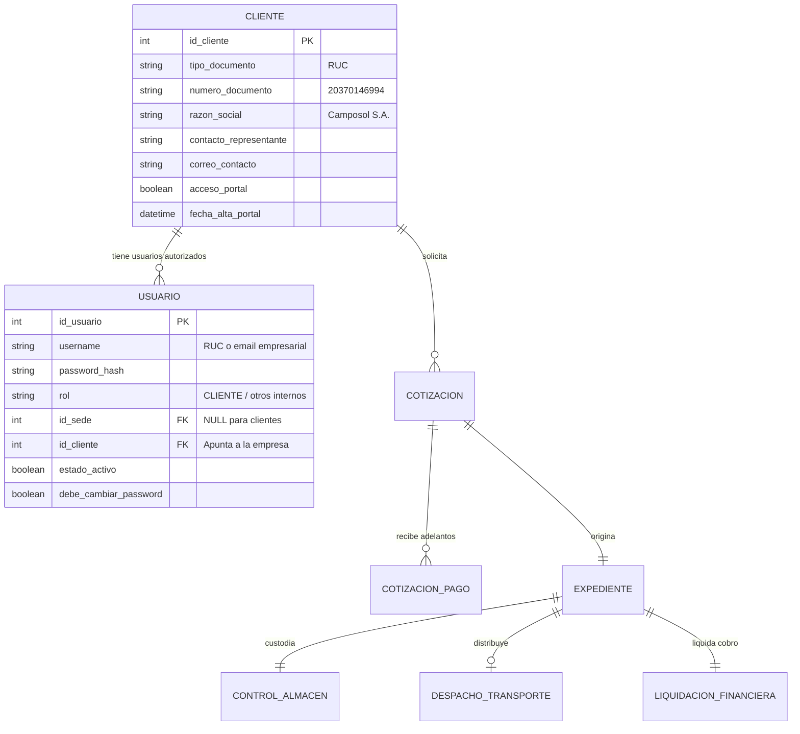
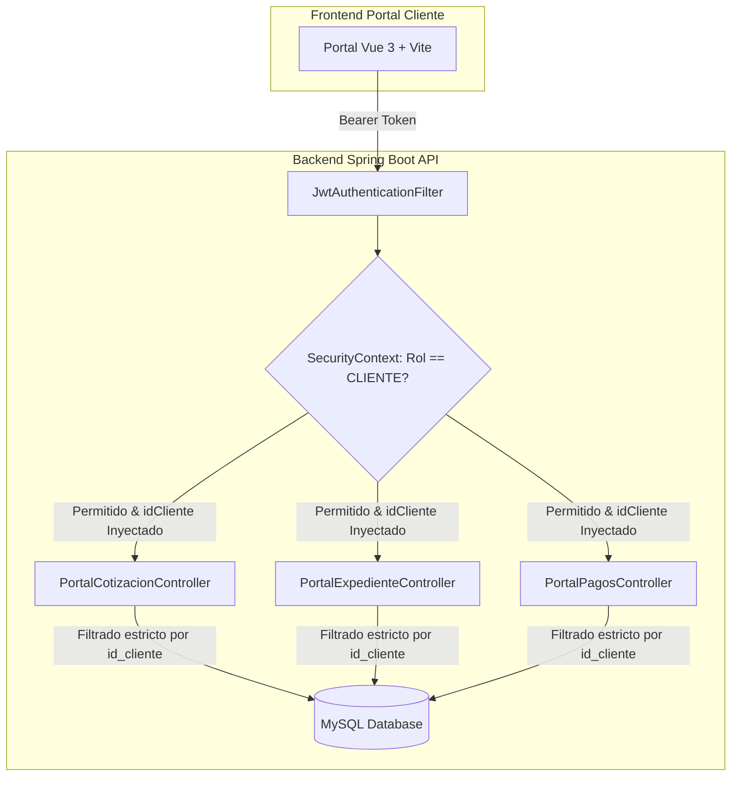

# INFORME TÉCNICO Y PLAN DE IMPLEMENTACIÓN: PLATAFORMA B2B DEL CLIENTE (PORTAL DEL CLIENTE)

**Proyecto:** TransAduanas - Sistema de Gestión Aduanera y Logística (SGA)  
**Documento:** Propuesta de Arquitectura, Modelo de Datos, API Backend y Plan de Desarrollo Frontend  
**Fecha:** 24 de Octubre de 2026  
**Versión:** 1.0  
**Autor:** Antigravity AI - Equipo de Arquitectura de Software  

---

## 1. Resumen Ejecutivo y Objetivos

### 1.1. Contexto y Propósito
El sistema actual **TransAduanas SGA** gestiona de manera centralizada las operaciones aduaneras, logísticas, de transporte y finanzas para el personal operativo interno (Agentes Comerciales, Supervisores Aduaneros, Contadores, Agentes de Transporte y Administradores de TI). 

Con el crecimiento del volumen de operaciones y la demanda de transparencia en tiempo real, surge la necesidad estratégica de habilitar una **Plataforma del Cliente (Portal B2B)**. Esta plataforma permitirá que cada empresa registrada en el sistema (por ejemplo, importadores y exportadores como *Camposol S.A.*, *Danper Trujillo S.A.C.*, *Ferreyros S.A.*, *Samsung Electronics*, etc.) cuente con usuarios propios para consultar en tiempo real sus cotizaciones, expedientes aduaneros con numeración DAM, canal SUNAT y control de pagos y liquidaciones financieras.

### 1.2. Directrices Clave de la Propuesta
1. **Frontend Desacoplado:** Creación de un proyecto frontend independiente en **Vue 3 + Vite** (`portal-cliente`), separado del ERP interno (`frontend`), con su propio ciclo de compilación, enrutamiento y despliegue.
2. **Identidad Visual Unificada (Warm Editorial Design System):** Adopción estricta del lenguaje de diseño existente: paleta cromática cálida (espresso `#352f2a`, arena `#ede6db`, marfil `#f6f3ee`), tipografía dual (**Inter** para UI ejecutiva y **JetBrains Mono** para datos numéricos y códigos aduaneros) y componentes **PrimeVue 4**.
3. **Backend Centralizado con Dominio Seguro (`/api/v1/portal/**`):** Mantenimiento del backend Spring Boot existente, incorporando un nuevo controlador y servicio especializado para clientes que garantiza **aislamiento estricto multitenant** (un cliente solo puede visualizar datos asociados a su RUC / `id_cliente`).
4. **Evolución de la Base de Datos:** Ajustes mínimos y no destructivos en el esquema relacional MySQL 8.4 para vincular la entidad `usuario` con `cliente`, habilitando el rol `CLIENTE`.
5. **Alcance Inicial de la Fase 1:**
   - **Módulo 1:** Inicio de sesión y perfil empresarial B2B.
   - **Módulo 2:** Consulta y seguimiento de Cotizaciones logísticas.
   - **Módulo 3:** Trazabilidad integral de Expedientes Aduaneros (Tracking DAM, Canal SUNAT, Almacén y Transporte).
   - **Módulo 4:** Gestión de Cobros y Pagos (Anticipos, Liquidaciones y carga de vouchers de pago).

---

## 2. Diagnóstico del Estado Actual

### 2.1. Modelo Relacional Actual (db/schema.sql)
En el esquema actual:
- La tabla `cliente` almacena la información tributaria y comercial de la empresa (`id_cliente`, `tipo_documento`, `numero_documento` [RUC], `razon_social`, `correo_contacto`, `telefono_contacto`).
- La tabla `usuario` modela exclusivamente al personal interno de la agencia aduanera (`id_usuario`, `rol`, `id_sede`, `username`, `password_hash`, `correo_institucional`, `codigo_sunat`).
- **Brecha 1:** No existe ninguna columna foránea (`id_cliente`) en `usuario` que vincule una cuenta de acceso con una empresa cliente.
- **Brecha 2:** La columna `id_sede` en `usuario` es aplicable al personal de oficinas aduaneras, pero no aplica a clientes externos.
- **Brecha 3:** No existe el rol `CLIENTE` en el enum `RolUsuario` ni en la matriz de seguridad `SecurityRoles.java`.

### 2.2. Lógica de Seguridad y Endpoints del Backend
- El mecanismo de seguridad se basa en **Stateless JWT** validado por `JwtAuthenticationFilter`.
- Los controladores existentes (`CotizacionController`, `ExpedienteController`, `LiquidacionFinancieraController`) están protegidos mediante anotaciones SpEL que restringen el acceso únicamente a roles internos:
  ```java
  @PreAuthorize(SecurityRoles.ACCESS_CLIENTE_COTIZACION_READ)
  // Permite: ADMINISTRADOR_TI, GERENTE_GENERAL, AGENTE_COMERCIAL, SUPERVISOR_ADUANERO, AGENTE_ADUANERO, CONTADOR, ASESOR_LEGAL
  ```
- Si un usuario externo ingresara a `/api/v1/cotizaciones`, recibiría un error HTTP `403 Forbidden`.
- Si se abriera dicho endpoint sin aislamiento, un cliente podría enviar `?idCliente=2` y consultar las cotizaciones confidenciales de otra empresa, lo que representaría una vulnerabilidad crítica de tipo **BOLA / IDOR (Broken Object Level Authorization)**.

### 2.3. Frontend Actual (frontend)
- Desarrollado en Vue 3 con Vite, Pinia, Vue Router y PrimeVue 4 con tema personalizado `SgaPreset` (`style.css` y `design-system.css`).
- La arquitectura actual contiene vistas operativas internas densas de gestión aduanera y recepción comercial con opciones de auditoría, edición y anulación que **no** deben ser visibles ni manipuladas por los clientes externos.
- La separación en un nuevo proyecto Vue + Vite garantiza que los clientes jamás descarguen bundles JavaScript con lógica o rutas de administración interna.

---

## 3. Modificaciones en la Base de Datos (DDL y Migración)

Para resolver las brechas identificadas sin alterar la integridad de las 16 tablas operativas existentes, se aplicará la siguiente migración SQL.

### 3.1. Script DDL de Migración (MySQL 8.4)

```sql
-- =============================================================================
-- MIGRACIÓN: HABILITACIÓN DE ACCESO B2B PARA EMPRESAS CLIENTES
-- =============================================================================

-- 1. Ampliar la tabla `cliente` con banderas de control del portal
ALTER TABLE cliente
    ADD COLUMN acceso_portal BOOLEAN NOT NULL DEFAULT FALSE COMMENT 'Indica si la empresa tiene acceso habilitado al portal B2B',
    ADD COLUMN fecha_alta_portal DATETIME NULL COMMENT 'Fecha y hora en que se activaron sus credenciales de portal';

-- 2. Modificar la tabla `usuario` para vincularla opcionalmente a un cliente
ALTER TABLE usuario
    ADD COLUMN id_cliente INT NULL AFTER id_sede,
    ADD COLUMN debe_cambiar_password BOOLEAN NOT NULL DEFAULT FALSE AFTER estado_activo;

-- 3. Crear restricción de clave foránea e índice para alto rendimiento
ALTER TABLE usuario
    ADD CONSTRAINT fk_usuario_cliente
    FOREIGN KEY (id_cliente) REFERENCES cliente (id_cliente)
    ON UPDATE CASCADE ON DELETE RESTRICT;

CREATE INDEX idx_usuario_cliente ON usuario (id_cliente);

-- 4. Modificar la columna `rol` para soportar el rol 'CLIENTE'
-- En MySQL el campo es VARCHAR(50), por lo que admite el nuevo valor directamente.
```

### 3.2. Modelo Entidad-Relación Resultante (Segmento de Acceso)



### 3.3. Población Inicial de Usuarios de Prueba (Seed Data)
Se configuran 3 cuentas empresariales de prueba con credenciales predecibles para el entorno de desarrollo y pruebas de aceptación:

| Empresa Cliente | RUC | Username de Acceso | Contraseña Inicial | Razón Social |
| :--- | :--- | :--- | :--- | :--- |
| **Camposol S.A.** | `20370146994` | `camposol` / `20370146994` | `Cliente123!` | Camposol S.A. |
| **Danper Trujillo** | `20440058771` | `danper` / `20440058771` | `Cliente123!` | Danper Trujillo S.A.C. |
| **Ferreyros S.A.** | `20100055237` | `ferreyros` / `20100055237` | `Cliente123!` | Ferreyros S.A. |

*Hash BCrypt utilizado para `Cliente123!`:* `$2a$10$w3v6nCgH/v9gS8T.7K0GReQ3sKqD4l8A2oM6jQ3X0F.0L8x3lXz2y` (o autogenerado con `PasswordEncoder`).

---

## 4. Arquitectura de la API Backend

Para garantizar seguridad absoluta, se implementa una capa dedicada bajo el namespace `/api/v1/portal/**`. De esta manera, el backend **ignora** cualquier parámetro `idCliente` que venga en la petición HTTP y siempre extrae el `id_cliente` del **Token JWT autenticado** a través del `SecurityContext`.

### 4.1. Modificaciones en el Núcleo del Backend

1. **`pe.sga.entity.enums.RolUsuario`**:
   ```java
   public enum RolUsuario {
       ADMINISTRADOR_TI("Administrador de TI"),
       GERENTE_GENERAL("Gerente General"),
       AGENTE_COMERCIAL("Agente Comercial"),
       SUPERVISOR_ADUANERO("Supervisor Aduanero"),
       AGENTE_ADUANERO("Agente Aduanero"),
       SUPERVISOR_TRANSPORTE("Supervisor de Transporte"),
       CONTADOR("Contador"),
       ASESOR_LEGAL("Asesor Legal"),
       CLIENTE("Cliente / Empresa B2B"); // <- Nuevo
   }
   ```

2. **`pe.sga.entity.Usuario`**:
   ```java
   @ManyToOne(fetch = FetchType.EAGER)
   @JoinColumn(name = "id_cliente")
   private Cliente cliente;

   @Column(name = "debe_cambiar_password", nullable = false)
   @Builder.Default
   private Boolean debeCambiarPassword = false;
   ```

3. **`pe.sga.config.SecurityRoles`**:
   ```java
   public static final String CLIENTE = "CLIENTE";
   public static final String ACCESS_PORTAL = "hasRole('" + CLIENTE + "')";
   ```

4. **Extensión del Payload JWT (`JwtTokenProvider`)**:
   El token emitido incluirá los claims del cliente para consumo del frontend y autorización interna:
   - `idUsuario`: ID de la cuenta de usuario.
   - `rol`: `CLIENTE`.
   - `idCliente`: ID numérico de la empresa asociada.
   - `ruc`: Número de RUC de la empresa.
   - `razonSocial`: Razón social de la empresa.

### 4.2. Catálogo de Servicios REST del Portal (`/api/v1/portal/**`)



#### A. Módulo de Autenticación & Perfil
- `POST /api/v1/auth/login`: Autentica al usuario (admite login con `username` o número de RUC). Retorna el token JWT con los datos de la empresa vinculada.
- `GET /api/v1/auth/me`: Retorna los datos del usuario autenticado, incluyendo datos completos del cliente (`razonSocial`, `ruc`, `direccionFiscal`, `correoContacto`).
- `PUT /api/v1/portal/perfil/password`: Permite al usuario de la empresa actualizar su contraseña de acceso.

#### B. Módulo de Cotizaciones (`PortalCotizacionController`)
- `GET /api/v1/portal/cotizaciones`: Retorna el historial y cotizaciones activas de la empresa con filtros por estado (`PENDIENTE`, `REVISADA`, `APROBADA`), rango de fechas y tipo de régimen (Importación/Exportación).
- `GET /api/v1/portal/cotizaciones/{id}`: Detalle completo de una cotización: desglose de costos (FOB, flete, seguro, honorarios aduaneros, tributos estimados), puertos de origen/destino y validez.
  > **Validación de Seguridad:** Si `cotizacion.getIdCliente() != usuario.getCliente().getIdCliente()`, arroja `403 Forbidden`.
- `POST /api/v1/portal/cotizaciones/solicitar`: Permite a la empresa solicitar una nueva cotización en línea enviando datos de la mercancía, valor FOB estimado y ruta de transporte.
- `PATCH /api/v1/portal/cotizaciones/{id}/aceptar`: Permite al cliente formalizar la aceptación de la cotización para dar paso a la orden aduanera.
- `GET /api/v1/portal/cotizaciones/{id}/pdf`: Descarga del documento PDF oficial timbrado con validez comercial.

#### C. Módulo de Expedientes Aduaneros (`PortalExpedienteController`)
- `GET /api/v1/portal/expedientes`: Listado de todos los despachos aduaneros de la empresa con sus respectivos estados (`ASIGNADO`, `NUMERADO`, `EN_CANAL`, `LEVANTE_AUTORIZADO`, `FINALIZADO`).
- `GET /api/v1/portal/expedientes/{id}`: Vista detallada del despacho:
  - Número de DAM oficial y fecha de numeración.
  - **Canal SUNAT:** Indicador visual (Verde: Levante inmediato, Naranja: Revisión documentaria, Rojo: Aforo físico) y detalle de inspección.
  - **Almacén Temporal:** Depósito asignado, ubicación, bultos, peso bruto y **contador de días libres restantes** antes de sobreestadía.
  - **Transporte y Despacho:** Unidad de transporte, placa tracto, conductor y fecha programada de entrega.
- `GET /api/v1/portal/expedientes/{id}/documentos`: Descarga de documentos oficiales adjuntos (Declaración Aduanera DAM, Acta de Levante, Guía de Remisión).

#### D. Módulo de Cobros y Pagos (`PortalPagosController`)
- `GET /api/v1/portal/pagos/estado-cuenta`: Resumen financiero consolidado (Total facturado, total amortizado y saldo pendiente en USD y PEN).
- `GET /api/v1/portal/pagos/anticipos`: Listado de pagos y adelantos requeridos por cotización para dar inicio al despacho aduanero.
- `GET /api/v1/portal/pagos/liquidaciones`: Listado de liquidaciones financieras finales vinculadas a expedientes con desglose de:
  - Tributos SUNAT (Ad-valorem, IGV, IPM, Percepción).
  - Gastos de Almacén y Puerto.
  - Flete de transporte terrestre local.
  - Honorarios profesionales de agenciamiento aduanero.
  - Detracción SPOT del 12% sujeta a depósito en Banco de la Nación.
- `POST /api/v1/portal/pagos/registrar-voucher`: Permite a la empresa registrar un abono bancario adjuntando la imagen o PDF del comprobante (`MultipartFile`), banco de origen, banco destino, número de operación bancaria, fecha y monto abonado. El sistema lo enruta automáticamente al buzón del Contador para su conciliación.

---

## 5. Arquitectura del Nuevo Proyecto Frontend (`portal-cliente`)

El frontend se construirá como una aplicación Single Page Application (SPA) en una carpeta hermana `/portal-cliente`, totalmente independiente de `/frontend`.

### 5.1. Stack Tecnológico del Frontend
- **Framework:** Vue 3 (Composition API con `<script setup>`).
- **Bundler & Dev Server:** Vite 6 / 8.
- **Enrutamiento:** Vue Router 4 con guardias de navegación para rutas protegidas y título dinámico.
- **Gestión de Estado:** Pinia 2.x para gestión reactiva de sesión, cliente activo y alertas.
- **Librería de Componentes:** PrimeVue 4 (Aura Theme personalizado con `SgaPreset`).
- **Iconografía:** PrimeIcons.
- **Cliente HTTP:** Axios con interceptores automáticos para inyección del header `Authorization: Bearer <token>` y captura unificada de errores 401/403.
- **Tipografía:** Google Fonts (**Inter** 400/500/600/700 y **JetBrains Mono** 400/500/600).

### 5.2. Estructura de Directorios del Proyecto (`portal-cliente`)

```text
portal-cliente/
├── index.html
├── package.json
├── vite.config.js
└── src/
    ├── main.js                          # Inicialización de Vue, PrimeVue 4, Pinia y Router
    ├── App.vue                          # Contenedor raíz con Toast y ConfirmDialog
    ├── style.css                        # Tokens CSS, variables de modo claro/oscuro
    ├── assets/
    │   ├── styles/
    │   │   ├── design-system.css        # Clases de utilidad y escala tipográfica oficial
    │   │   └── warm-theme.css          # Estilos de botones, inputs y tarjetas
    │   └── images/                      # Logotipo corporativo e isotipo
    ├── core/
    │   ├── api/
    │   │   └── apiClient.js             # Instancia Axios con interceptores de Token
    │   ├── layouts/
    │   │   ├── PortalLayout.vue         # Layout maestro con Topbar y Sidebar colapsable
    │   │   ├── components/
    │   │   │   ├── PortalHeader.vue     # Datos de la empresa, RUC, switch dark mode y logout
    │   │   │   ├── PortalSidebar.vue    # Navegación rápida minimalista
    │   │   │   └── PortalFooter.vue     # Metadatos legales y soporte 24/7
    │   ├── router/
    │   │   └── index.js                 # Rutas y guardias de autenticación
    │   └── stores/
    │       ├── authStore.js             # Estado de sesión JWT y datos de la empresa
    │       └── portalStore.js           # Caché de cotizaciones, expedientes y pagos
    ├── features/
    │   ├── auth/
    │   │   ├── views/
    │   │   │   └── PortalLoginView.vue  # Vista de inicio de sesión B2B corporativo
    │   │   └── services/
    │   │       └── authService.js
    │   ├── cotizaciones/
    │   │   ├── views/
    │   │   │   ├── CotizacionesListView.vue # Bandeja interactiva de cotizaciones
    │   │   │   └── CotizacionDetailModal.vue # Desglose de costos y descarga PDF
    │   │   └── services/
    │   │       └── cotizacionService.js
    │   ├── expedientes/
    │   │   ├── views/
    │   │   │   ├── ExpedientesTrackingView.vue # Tracking en vivo y semáforo SUNAT
    │   │   │   └── components/
    │   │   │       ├── DamTimelineStep.vue     # Línea de tiempo interactiva
    │   │   │       └── AlmacenCountdown.vue    # Alerta visual de días libres
    │   │   └── services/
    │   │       └── expedienteService.js
    │   └── pagos/
    │       ├── views/
    │       │   ├── CobrosPagosView.vue      # Estado de cuenta y liquidaciones
    │       │   └── RegistrarVoucherModal.vue # Carga de comprobante de pago
    │       └── services/
    │           └── pagosService.js
    └── shared/
        ├── components/                  # Botones ejecutivos, KPI cards, badges
        ├── composables/
        │   ├── useTheme.js              # Switch modo claro / modo oscuro
        │   └── useCurrency.js           # Formateador de USD y PEN con JetBrains Mono
        └── utils/
            └── download.js              # Descarga de PDFs y documentos en base64/blob
```

---

## 6. Especificación de Diseño de las 4 Vistas Clave

En estricta conformidad con el **Manual del Lenguaje de Diseño Oficial (SGA Design System)**, la interfaz adoptará la estética **Warm Editorial**: superficies cálidas en lino/arena, bordes definidos en marfil y detalles en espresso profundo y bronce.

### 6.1. Vista 1: Inicio de Sesión B2B (`PortalLoginView.vue`)

#### Concepto Visual y Experiencia de Usuario:
- Tarjeta central flotante en modo editorial minimalista sobre fondo cálido con gradiente sutil.
- Cabecera con isotipo de protección aduanera (`pi-shield-check`) y títulos de alto impacto: *"TransAduanas — Portal del Cliente"*.
- Subtítulo descriptivo: *"Acceso corporativo para empresas importadoras y exportadoras"*.
- Campos de entrada de alta accesibilidad con iconos integrados:
  - **Identificador Empresarial:** Admite RUC (11 dígitos) o nombre de usuario registrado.
  - **Contraseña:** Input con botón toggle para ver/ocultar contraseña.
  - **Opción "Recordar credenciales":** Checkbox estético nativo.
- Botón principal de acción en Espresso Cálido (`#352f2a`) con feedback de carga (`pi-spinner`).
- Bloque inferior de asistencia: *"¿Problemas para acceder a su cuenta empresarial? Contacte a su Agente Comercial asignado o a soporte@transaduanas.pe"*.

```
+-------------------------------------------------------+
|                 [ Logo TransAduanas ]                 |
|            TransAduanas — Portal del Cliente          |
|    Acceso corporativo para importadores y exportadores|
+-------------------------------------------------------+
|  RUC o Usuario Empresarial                            |
|  [ 20370146994                                      ] |
|                                                       |
|  Contraseña de Seguridad                              |
|  [ ••••••••••••••••                              (o) ]|
|                                                       |
|  [ ] Recordar sesión en este equipo                   |
|                                                       |
|  [       INGRESAR AL PORTAL EMPRESARIAL        --> ]  |
+-------------------------------------------------------+
|  ¿Olvidó su contraseña? Contacte a su Agente Aduanero |
+-------------------------------------------------------+
```

---

### 6.2. Vista 2: Mis Cotizaciones (`CotizacionesListView.vue`)

#### Concepto Visual y Funcionalidades:
- **Barra de Métricas (KPI Cards Superiores):**
  1. *Total Cotizaciones Vigentes* (con badge de validez en días).
  2. *Cotizaciones Aprobadas* (listas para despacho).
  3. *En Revisión Técnica* (agente aduanero evaluando subpartidas arancelarias).
- **Herramientas de Filtrado:**
  - Buscador reactivo por código (`COT-2026-XXXX`) o mercancía.
  - Selector de Régimen: *Todos*, *Importación Definitiva*, *Exportación Definitiva*.
  - Selector de Estado: *Pendiente*, *Aprobada*, *Observada*, *Vencida*.
- **Tabla Ejecutiva de Cotizaciones:**
  - Columnas: Código, Mercancía, Régimen, Origen/Destino, Valor FOB, Total Estimado (USD), Estado Comercial, Acciones.
  - Cifras formateadas en fuente monoespaciada `JetBrains Mono` con alineación derecha.
  - Badges semánticos suaves: Verde (`APROBADA`), Ámbar (`PENDIENTE`), Rojo (`RECHAZADA`).
- **Modal de Detalle y Desglose Financiero (`CotizacionDetailModal.vue`):**
  - Desglose transparente de flete internacional, seguro estimado, honorarios de agenciamiento y tributos estimados (Ad-valorem, IGV, IPM, Percepción).
  - Botón prominente de **Descargar Cotización Oficial en PDF**.
  - Botón de **"Aceptar y Proceder a Despacho"** para autorizar el avance operativo.

---

### 6.3. Vista 3: Seguimiento de Expedientes & Tracking DAM (`ExpedientesTrackingView.vue`)

#### Concepto Visual y Funcionalidades:
Esta es la vista de mayor valor agregado para el cliente, diseñada para responder en 3 segundos la pregunta: *"¿Dónde está mi carga y en qué estado se encuentra en SUNAT?"*.

```
+---------------------------------------------------------------------------------------------------+
| EXP-2026-0012 | DAM: 118-2026-10-004523 | CANAL SUNAT: [ VERDE - LEVANTE AUTORIZADO ]              |
| Mercancía: Smartphone / Tecnología | Nave: MSC GÜLSÜN V-420 | Bultos: 850 | Peso: 14,200 kg       |
+---------------------------------------------------------------------------------------------------+
|  LÍNEA DE TIEMPO OPERATIVA (STEPPER)                                                              |
|  (✓) Cotización -> (✓) Pago Anticipo -> (✓) DAM Numerada -> (✓) Canal Asignado -> (•) Almacén / Tr |
+---------------------------------------------------------------------------------------------------+
|  [ TARJETA: ALMACÉN TEMPORAL ]                 |  [ TARJETA: TRANSPORTE Y ENTREGA ]               |
|  Depósito: DP World Callao                     |  Unidad: Tracto ACTROS (Placa: D3T-890)          |
|  Ubicación: Bahía A-4 / Patio General          |  Conductor: Wilmer Galarza Silva                 |
|  Días Libres Restantes: [ 7 DÍAS RESTANTES ]   |  Destino: Av. Panamericana Norte Km 497, Chao    |
|  Fecha Límite Retiro: 28/10/2026               |  Estado: En ruta de entrega programada           |
+---------------------------------------------------------------------------------------------------+
|  DOCUMENTOS ASOCIADOS AL EXPEDIENTE:                                                              |
|  [PDF] DAM_118_2026.pdf (Descargar) | [PDF] Guia_Remision_T001.pdf (Descargar)                   |
+---------------------------------------------------------------------------------------------------+
```

- **Semáforo Inteligente de Canales SUNAT:**
  - **Verde:** Badge suave verde (`#1e6638`) con tooltip: *"Levante aduanero inmediato sin revisión física"*.
  - **Naranja:** Badge suave ámbar (`#8c5b16`) con tooltip: *"Revisión de documentación técnica por especialista SUNAT"*.
  - **Rojo:** Badge suave coral (`#9e2a2b`) con tooltip: *"Revisión documentaria y aforo físico programado en almacén"*.
- **Alerta de Sobrecostos de Almacén:** Widget con cuenta regresiva de los 15 días libres de almacenaje para evitar penalidades de sobreestadía.
- **Bóveda Documental:** Acceso directo a descargar copias auténticas de la DAM, tickets de pesaje, guías de remisión y actas de levante.

---

### 6.4. Vista 4: Cobros, Pagos y Liquidaciones (`CobrosPagosView.vue`)

#### Concepto Visual y Funcionalidades:
- **Tarjeta de Estado Financiero General:**
  - Total Facturado (USD y PEN).
  - Total Abonado / Conciliado.
  - **Saldo Pendiente de Pago** resaltado en tipografía destacada.
- **Pestaña 1: Anticipos de Cotización (Pre-Expediente):**
  - Muestra los adelantos requeridos para iniciar el trámite aduanero.
  - Estado del abono: `PENDIENTE`, `EN_REVISION`, `CONCILIADO`.
- **Pestaña 2: Liquidaciones Finales de Despacho:**
  - Desglose auditable de la cobranza consolidada:
    - Impuestos y Aranceles pagados a la SUNAT.
    - Facturación del depósito temporal / terminal portuario.
    - Servicio de flete de transporte local.
    - Comisión / Honorarios de TransAduanas.
    - Constancia de retención de **Detracción SPOT (12%)**.
- **Acción Interactiva: "Registrar Comprobante de Pago" (`RegistrarVoucherModal.vue`):**
  - Modal intuitivo donde el cliente selecciona la obligación a pagar (Cotización o Liquidación).
  - Formulario de registro bancario:
    - Banco Emisor (BCP, BBVA, Scotiabank, Interbank, etc.).
    - Cuenta Receptora de TransAduanas.
    - Número de Operación Bancaria.
    - Fecha y Monto Transferido.
    - Área Drag & Drop para subir imagen o PDF del voucher bancario.
  - Al enviar, el abono queda en estado `PENDIENTE_VALIDACION` en la bandeja del Contador interno, notificando al cliente tan pronto como sea validado.

---

## 7. Plan de Implementación Paso a Paso

El plan se estructura en **5 fases ordenadas**, estimando una ejecución eficiente y sin fricciones con el sistema existente en producción.

```mermaid
gantt
    title Cronograma de Implementación: Plataforma del Cliente SGA
    dateFormat  YYYY-MM-DD
    section Fase 1: Datos y Seguridad
    Migración DDL y Relación Usuario-Cliente      :f1_1, 2026-10-25, 2d
    Ajustes en Entidades y Seguridad JWT          :f1_2, after f1_1, 2d
    section Fase 2: Backend API
    Controladores y Servicios /api/v1/portal/**   :f2_1, after f1_2, 4d
    Pruebas Unitarias e Integración Backend       :f2_2, after f2_1, 2d
    section Fase 3: Scaffold Frontend
    Creación del Proyecto portal-cliente en Vite :f3_1, after f2_2, 1d
    Configuración de PrimeVue 4 y Design System   :f3_2, after f3_1, 2d
    section Fase 4: Vistas Frontend
    Módulo 1: Login y Perfil B2B                  :f4_1, after f3_2, 2d
    Módulo 2: Vista de Cotizaciones               :f4_2, after f4_1, 3d
    Módulo 3: Vista de Expedientes y Tracking     :f4_3, after f4_2, 3d
    Módulo 4: Cobros, Pagos y Carga de Vouchers   :f4_4, after f4_3, 3d
    section Fase 5: QA y Puesta en Marcha
    Pruebas de Seguridad B2B y Carga E2E         :f5_1, after f4_4, 3d
    Documentación Final y Despliegue              :f5_2, after f5_1, 2d
```

### Detalle de Fases:

#### Fase 1: Base de Datos y Seguridad Backend (Días 1 - 4)
- [ ] Ejecutar script de migración SQL para agregar `id_cliente` y `debe_cambiar_password` a `usuario`, y `acceso_portal` a `cliente`.
- [ ] Actualizar entidad JPA `Usuario.java` y enum `RolUsuario.java` agregando `CLIENTE`.
- [ ] Configurar constantes de autorización en `SecurityRoles.java`.
- [ ] Enriquecer el JWT en `JwtTokenProvider.java` para serializar `idCliente`, `ruc` y `razonSocial`.
- [ ] Actualizar `UsuarioServiceImpl.java` para que el método de autenticación acepte tanto `username` como número de `RUC`.
- [ ] Cargar seeds de usuarios de prueba para clientes clave (*Camposol*, *Danper*, *Ferreyros*).

#### Fase 2: Implementación de Endpoints del Portal en Backend (Días 5 - 10)
- [ ] Crear paquete `pe.sga.controller.portal` y clase base de seguridad.
- [ ] Desarrollar `PortalCotizacionController.java` y `IPortalCotizacionService`.
- [ ] Desarrollar `PortalExpedienteController.java` y `IPortalExpedienteService` con timeline y cálculo de días libres.
- [ ] Desarrollar `PortalPagosController.java` con endpoints de estado de cuenta y recepción de comprobantes multipart.
- [ ] Implementar DTOs optimizados para cliente (`PortalCotizacionDTO`, `PortalExpedienteDTO`, `PortalLiquidacionDTO`, `RegistroVoucherDTO`).
- [ ] Validar que ninguna consulta permita acceder a registros de otro `id_cliente`.

#### Fase 3: Creación e Inicialización del Nuevo Proyecto Frontend (Días 11 - 13)
- [ ] Inicializar nuevo proyecto Vite: `npm create vite@latest portal-cliente -- --template vue`.
- [ ] Instalar dependencias exactas: `pinia`, `vue-router`, `axios`, `primevue`, `@primevue/themes`, `primeicons`.
- [ ] Replicar la configuración de temas corporativos (`SgaPreset` en `main.js`, `style.css` y `design-system.css`).
- [ ] Configurar cliente Axios con interceptores y lectura reactiva de tokens JWT.
- [ ] Construir el `PortalLayout.vue` con Topbar ejecutiva, selector de modo oscuro y Sidebar adaptada para clientes.

#### Fase 4: Implementación de Vistas del Portal (Días 14 - 24)
- [ ] **Módulo 1:** Desarrollar `PortalLoginView.vue` con soporte de login por RUC o usuario y mensajes claros de validación.
- [ ] **Módulo 2:** Desarrollar `CotizacionesListView.vue` y modal de desglose con descarga de PDF.
- [ ] **Módulo 3:** Desarrollar `ExpedientesTrackingView.vue` con línea de tiempo, semáforo SUNAT (Verde/Naranja/Rojo) y contador de días libres en almacén.
- [ ] **Módulo 4:** Desarrollar `CobrosPagosView.vue` con desglose de anticipos, liquidaciones de tributos, detracción SPOT y modal de subida de vouchers.

#### Fase 5: Pruebas Integrales, Aseguramiento de Calidad y Despliegue (Días 25 - 29)
- [ ] Pruebas de penetración y control de acceso (verificar que cliente A no pueda descargar documentos o ver cotizaciones de cliente B).
- [ ] Pruebas de responsividad (compatibilidad en pantallas de escritorio ejecutivas, laptops y tablets).
- [ ] Validación de subida de archivos (formatos PDF, PNG, JPG, límite de 25 MB).
- [ ] Configuración del puerto de desarrollo (ej. puerto 5174 para no colisionar con el frontend interno en 5173).
- [ ] Preparación de scripts Docker y documentación de despliegue en producción.

---

## 8. Matriz de Seguridad y Reglas de Dominio B2B

1. **Aislamiento Multitenant Lógico:**
   Cada petición autenticada pasa por `JwtAuthenticationFilter`. En todos los servicios del portal, el filtro SQL siempre aplica:
   ```sql
   WHERE id_cliente = :idClienteAutenticado
   ```
   Bajo ninguna circunstancia se permite que el cliente pase un parámetro `idCliente` en el query string o payload JSON que altere el contexto autenticado.

2. **Sanitización y Validación de Comprobantes Bancarios:**
   - La carga de comprobantes en `POST /api/v1/portal/pagos/registrar-voucher` valida extensiones permitidas (`.pdf`, `.jpg`, `.jpeg`, `.png`) y verifica encabezados mágicos MIME reales para evitar archivos maliciosos.
   - El almacenamiento físico reutiliza el servicio consolidado `LocalStorageServiceImpl` con nombres UUID únicos e indexación en la tabla `documento_adjunto`.

3. **Auditoría de Pagos Registrados por Clientes:**
   Todo abono registrado por un cliente nace obligatoriamente en estado `PENDIENTE_REVISION`. Solo un usuario interno con rol `CONTADOR` o `ADMINISTRADOR_TI` puede marcar el abono como `VALIDADO`, garantizando que ningún cliente pueda autoaprobarse pagos sin verificación en extracto bancario.

4. **Preservación de Márgenes Internos:**
   Los DTOs del portal omiten los costos internos de intermediación o notas de supervisión interna que pertenecen exclusivamente al control de la agencia aduanera.

---

## 9. Conclusiones y Próximos Pasos

La estrategia planteada permite implementar la **Plataforma del Cliente B2B** con las siguientes garantías:
1. **Riesgo Cero para el Sistema Actual:** El backend mantiene su estabilidad y los cambios en la base de datos son aditivos (no destructivos).
2. **Independencia Operativa:** Al residir en un proyecto Vue + Vite independiente (`portal-cliente`), el equipo puede desplegar mejoras continuas en la experiencia del cliente sin afectar la intranet del personal aduanero.
3. **Consistencia Visual Absoluta:** Ambos frontends comparten la misma identidad de alta gama (*Warm Editorial Design System*), proyectando una imagen de liderazgo, solidez y modernidad tecnológica en el comercio exterior peruano.

**Acción Inmediata Sugerida:**  
Una vez revisada y aprobada esta propuesta, procederemos de inmediato con la **Fase 1** (ejecución del script DDL y configuración de seguridad en el backend) para posteriormente inicializar el nuevo repositorio y proyecto frontend `portal-cliente`.
