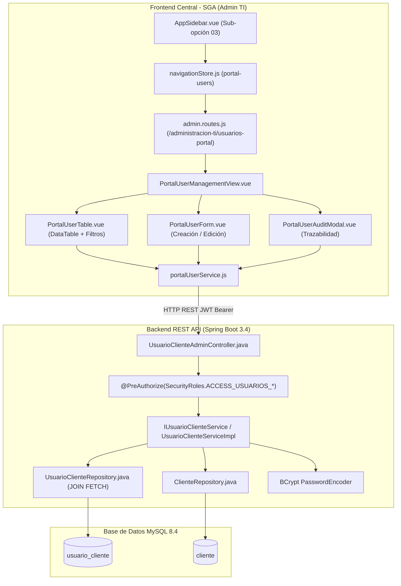
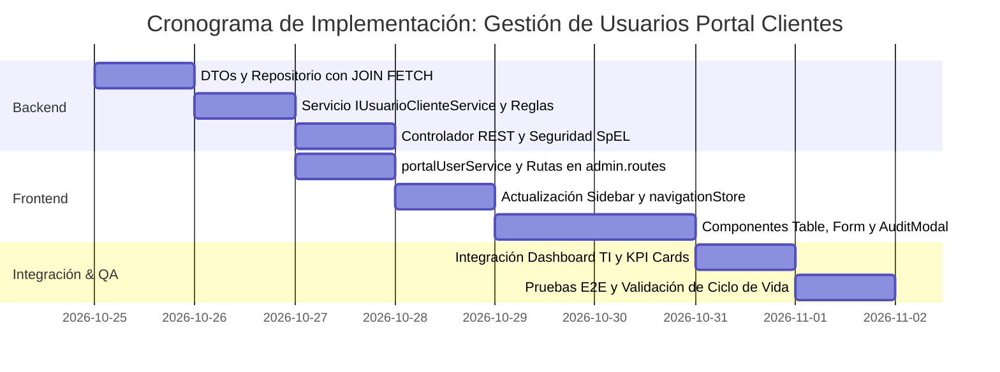

# INFORME TÉCNICO Y PLAN DE IMPLEMENTACIÓN: ADMINISTRACIÓN Y GESTIÓN DE USUARIOS DEL PORTAL CLIENTES (B2B) EN EL MÓDULO DE TI

**Proyecto:** TransAduanas - Sistema de Gestión Aduanera y Logística (SGA)  
**Documento:** Plan de Implementación de Gestión y Auditoría de Cuentas B2B en la Consola de Administración TI  
**Fecha:** 24 de Octubre de 2026  
**Versión:** 1.0  
**Autor:** Antigravity AI - Equipo de Arquitectura de Software  

---

## 1. Resumen Ejecutivo y Objetivos

### 1.1. Contexto Operativo y Problemática
Tras la culminación de la primera fase del **Portal del Cliente (Plataforma B2B)**, el sistema cuenta con dos aplicaciones frontend desacopladas:
1. **Frontend Principal (`frontend`):** Aplicación de escritorio web interna para el personal operativo de TransAduanas (Agentes Comerciales, Supervisores Aduaneros, Contadores, Agentes de Transporte y Administradores TI).
2. **Portal B2B de Clientes (`portal-cliente`):** Aplicación web externa independiente donde los representantes de empresas importadoras y exportadoras (tales como *Camposol S.A.*, *Danper Trujillo S.A.C.*, *Ferreyros S.A.*, *Samsung Electronics*, etc.) acceden a consultar sus cotizaciones, seguimiento aduanero (DAM, canal SUNAT) y control de cobros/pagos.

En el modelo de datos backend, las credenciales y perfiles de los usuarios del portal residen en la tabla `usuario_cliente` (entidad JPA `UsuarioCliente.java`), la cual cuenta con aislamiento lógico y relación directa con la entidad `Cliente.java`.

**Problema Identificado:**  
Actualmente, el sistema no cuenta con ninguna pantalla, formulario ni endpoints administrativos en la plataforma central para que el equipo de TI o la Gerencia General puedan:
- Visualizar el directorio de todos los usuarios de clientes creados para el portal B2B.
- Registrar nuevos accesos corporativos asociados a empresas clientes activas.
- Modificar datos de contacto, nombres, cargos o roles de un usuario del portal.
- Desactivar (baja lógica por estado `estadoActivo = false`) o reactivar cuentas de clientes.
- Restablecer contraseñas de acceso al portal o forzar cambio de contraseña.
- Auditar la actividad de cada cuenta (fecha de creación, última modificación, fecha/hora de último acceso al portal y trazabilidad de operaciones).

### 1.2. Objetivo General
Diseñar e implementar una nueva sub-opción dentro de la consola de **Administración TI (`00 ADMINISTRACIÓN TI`)** del sistema central, denominada **"Usuarios Portal Clientes"**, que equipe a los Administradores de TI con todas las herramientas de gestión, ciclo de vida (CRUD con baja lógica), auditoría y exportación que ya existen para los operadores internos en la tabla de usuarios, manteniendo la consistencia estética y funcional del lenguaje de diseño *Warm Editorial*.

---

## 2. Diagnóstico del Estado Actual y Brechas Identificadas

### 2.1. Modelo Relacional (`usuario_cliente` vs `usuario`)
En la base de datos MySQL 8.4 (`db/schema.sql`):
```sql
CREATE TABLE usuario_cliente (
    id_usuario_cliente INT NOT NULL AUTO_INCREMENT,
    id_cliente INT NOT NULL,
    username VARCHAR(100) NOT NULL,
    password_hash VARCHAR(255) NOT NULL,
    nombres VARCHAR(100) NOT NULL,
    apellidos VARCHAR(100) NOT NULL,
    correo_electronico VARCHAR(150) NOT NULL,
    telefono_contacto VARCHAR(30) NULL,
    cargo_empresa VARCHAR(100) NULL,
    rol_portal VARCHAR(50) NOT NULL DEFAULT 'ADMIN_EMPRESA',
    estado_activo BOOLEAN NOT NULL DEFAULT TRUE,
    debeCambiarPassword BOOLEAN NOT NULL DEFAULT FALSE,
    ultimo_acceso DATETIME NULL,
    fecha_creacion DATETIME NOT NULL DEFAULT CURRENT_TIMESTAMP,
    fecha_actualizacion DATETIME NOT NULL DEFAULT CURRENT_TIMESTAMP ON UPDATE CURRENT_TIMESTAMP,
    PRIMARY KEY (id_usuario_cliente),
    CONSTRAINT uq_usrcli_username UNIQUE (username),
    CONSTRAINT fk_usrcli_cliente FOREIGN KEY (id_cliente) REFERENCES cliente (id_cliente) ON UPDATE CASCADE ON DELETE RESTRICT
);
```

| Atributo | Tabla `usuario` (Personal Interno) | Tabla `usuario_cliente` (Portal B2B) |
| :--- | :--- | :--- |
| **Población Objetivo** | Empleados de la agencia aduanera | Representantes y delegados de empresas clientes |
| **Relación Foránea** | `id_sede` (Sede física operativa) | `id_cliente` (Empresa comercial / RUC) |
| **Catálogo de Roles** | `RolUsuario` (enum: ADMIN_TI, COMERCIAL, etc.) | `rol_portal` (ADMIN_EMPRESA, OPERADOR_LOGISTICO, etc.) |
| **Autenticación** | `/api/v1/auth/login` (ERP central) | `/api/v1/portal/auth/login` (Portal clientes) |
| **Consola de Gestión Actual** | `UserManagementView.vue` en Admin TI | **Inexistente (Requiere desarrollo)** |

### 2.2. Brechas en la Capa Backend (Spring Boot 3.4)
1. **Falta de Endpoints Administrativos:** Actualmente, `PortalController.java` contiene endpoints de uso exclusivo para el cliente autenticado (`@PreAuthorize("hasRole('CLIENTE_PORTAL')")`). No existe un controlador que exponga operaciones protegidas por `@PreAuthorize(SecurityRoles.ACCESS_USUARIOS_WRITE)` o `ACCESS_USUARIOS_READ` para gestionar `UsuarioCliente`.
2. **Repositorio sin Consultas de Auditoría Multicriterio:** `UsuarioClienteRepository.java` solo cuenta con búsquedas básicas por username, email o ID de cliente. Se requiere una consulta optimizada con `JOIN FETCH u.cliente` y soporte para filtros dinámicos (búsqueda textual por nombre/RUC/razón social, filtrado por empresa y filtrado por estado activo/inactivo) evitando el antipatrón de consultas $N+1$.
3. **Ausencia de DTOs Administrativos:** Se necesitan DTOs especializados para alta, edición y respuesta con datos enriquecidos de la empresa vinculada (`rucCliente`, `razonSocialCliente`, timestamps de auditoría).

### 2.3. Brechas en la Capa Frontend (Vue 3 + Vite)
1. **Navegación y Rutas:** `frontend/src/features/admin/users/routes/admin.routes.js` solo expone `/administracion-ti/dashboard`, `/usuarios`, `/logs` y `/acerca-de`. No existe la ruta `/administracion-ti/usuarios-portal`.
2. **Sidebar:** `AppSidebar.vue` contiene las sub-opciones 01 a 04 para TI. Falta insertar la nueva sub-opción **03: Usuarios Portal Clientes** e integrarla con `navigationStore.js`.
3. **Componentes UI:** No existe la vista maestra `PortalUserManagementView.vue`, ni la tabla con filtros `PortalUserTable.vue`, ni los modales/formularios `PortalUserFormModal.vue` y `PortalUserAuditModal.vue`.

---

## 3. Arquitectura de la Solución Técnica



---

## 4. Especificación Detallada del Backend

### 4.1. DTOs de Administración (`pe.sga.dto.portal.admin`)

#### 1. `UsuarioClienteResponseDTO.java`
Objeto de transferencia para visualización en tablas, fichas y reportes:
```java
package pe.sga.dto.portal.admin;

import lombok.*;
import java.time.LocalDateTime;

@Getter
@Setter
@NoArgsConstructor
@AllArgsConstructor
@Builder
public class UsuarioClienteResponseDTO {
    private Integer idUsuarioCliente;
    // Datos de la empresa cliente
    private Integer idCliente;
    private String rucCliente;
    private String razonSocialCliente;
    private String direccionFiscalCliente;
    // Datos del usuario B2B
    private String username;
    private String nombres;
    private String apellidos;
    private String nombreCompleto;
    private String correoElectronico;
    private String telefonoContacto;
    private String cargoEmpresa;
    private String rolPortal; // ADMIN_EMPRESA, OPERADOR_LOGISTICO, CONSULTOR_FINANCIERO, CONSULTA
    // Estado y seguridad
    private Boolean estadoActivo;
    private Boolean debeCambiarPassword;
    private LocalDateTime ultimoAcceso;
    // Auditoría
    private LocalDateTime fechaCreacion;
    private LocalDateTime fechaActualizacion;
}
```

#### 2. `UsuarioClienteCreateDTO.java`
Validaciones para el aprovisionamiento de un nuevo acceso empresarial:
```java
package pe.sga.dto.portal.admin;

import jakarta.validation.constraints.*;
import lombok.*;

@Getter
@Setter
@NoArgsConstructor
@AllArgsConstructor
@Builder
public class UsuarioClienteCreateDTO {

    @NotNull(message = "El cliente empresarial es obligatorio")
    private Integer idCliente;

    @NotBlank(message = "El nombre de usuario es obligatorio")
    @Size(min = 3, max = 100, message = "El usuario debe tener entre 3 y 100 caracteres")
    @Pattern(regexp = "^[a-zA-Z0-9._-]+$", message = "El usuario solo puede contener letras, números, puntos, guiones y guiones bajos")
    private String username;

    @NotBlank(message = "La contraseña temporal es obligatoria")
    @Size(min = 6, max = 100, message = "La contraseña debe tener al menos 6 caracteres")
    private String password;

    @NotBlank(message = "Los nombres son obligatorios")
    @Size(max = 100, message = "Los nombres no pueden exceder 100 caracteres")
    private String nombres;

    @NotBlank(message = "Los apellidos son obligatorios")
    @Size(max = 100, message = "Los apellidos no pueden exceder 100 caracteres")
    private String apellidos;

    @NotBlank(message = "El correo electrónico es obligatorio")
    @Email(message = "El formato del correo electrónico no es válido")
    @Size(max = 150, message = "El correo no puede exceder 150 caracteres")
    private String correoElectronico;

    @Size(max = 30, message = "El teléfono no puede exceder 30 caracteres")
    private String telefonoContacto;

    @Size(max = 100, message = "El cargo en la empresa no puede exceder 100 caracteres")
    private String cargoEmpresa;

    @NotBlank(message = "El rol del portal es obligatorio")
    @Builder.Default
    private String rolPortal = "ADMIN_EMPRESA";

    @Builder.Default
    private Boolean debeCambiarPassword = true;
}
```

#### 3. `UsuarioClienteUpdateDTO.java`
Para modificar datos personales, de contacto y rol operativo de la cuenta:
```java
package pe.sga.dto.portal.admin;

import jakarta.validation.constraints.*;
import lombok.*;

@Getter
@Setter
@NoArgsConstructor
@AllArgsConstructor
@Builder
public class UsuarioClienteUpdateDTO {

    @NotBlank(message = "Los nombres son obligatorios")
    @Size(max = 100)
    private String nombres;

    @NotBlank(message = "Los apellidos son obligatorios")
    @Size(max = 100)
    private String apellidos;

    @NotBlank(message = "El correo electrónico es obligatorio")
    @Email
    @Size(max = 150)
    private String correoElectronico;

    @Size(max = 30)
    private String telefonoContacto;

    @Size(max = 100)
    private String cargoEmpresa;

    @NotBlank(message = "El rol del portal es obligatorio")
    private String rolPortal;

    @NotNull(message = "El estado activo es obligatorio")
    private Boolean estadoActivo;

    private Boolean debeCambiarPassword;
}
```

#### 4. `UsuarioClienteResetPasswordDTO.java`
Para restablecer credenciales en caso de olvido o renovación forzada por TI:
```java
package pe.sga.dto.portal.admin;

import jakarta.validation.constraints.NotBlank;
import jakarta.validation.constraints.Size;
import lombok.*;

@Getter
@Setter
@NoArgsConstructor
@AllArgsConstructor
@Builder
public class UsuarioClienteResetPasswordDTO {

    @NotBlank(message = "La nueva contraseña es obligatoria")
    @Size(min = 6, max = 100, message = "La contraseña debe tener entre 6 y 100 caracteres")
    private String nuevaPassword;

    @Builder.Default
    private Boolean forzarCambioPrimerInicio = true;
}
```

---

### 4.2. Ampliación del Repositorio (`UsuarioClienteRepository.java`)
Se añaden consultas optimizadas con `JOIN FETCH` y búsqueda dinámica:
```java
package pe.sga.repository;

import org.springframework.data.jpa.repository.JpaRepository;
import org.springframework.data.jpa.repository.Query;
import org.springframework.data.repository.query.Param;
import pe.sga.entity.UsuarioCliente;

import java.util.List;
import java.util.Optional;

public interface UsuarioClienteRepository extends JpaRepository<UsuarioCliente, Integer> {

    Optional<UsuarioCliente> findByUsername(String username);

    Optional<UsuarioCliente> findByCorreoElectronico(String correoElectronico);

    List<UsuarioCliente> findByCliente_NumeroDocumento(String ruc);

    List<UsuarioCliente> findByCliente_IdCliente(Integer idCliente);

    boolean existsByUsername(String username);

    boolean existsByCorreoElectronico(String correoElectronico);

    // Consulta con JOIN FETCH para evitar N+1 queries al listar usuarios en la tabla de administración
    @Query("SELECT uc FROM UsuarioCliente uc JOIN FETCH uc.cliente c ORDER BY uc.idUsuarioCliente DESC")
    List<UsuarioCliente> findAllWithCliente();

    // Consulta con filtros dinámicos opcionales
    @Query("SELECT uc FROM UsuarioCliente uc JOIN FETCH uc.cliente c " +
           "WHERE (:idCliente IS NULL OR c.idCliente = :idCliente) " +
           "AND (:soloActivos = false OR uc.estadoActivo = true) " +
           "AND (:rolPortal IS NULL OR uc.rolPortal = :rolPortal) " +
           "AND (:termino IS NULL OR (" +
           "   LOWER(uc.username) LIKE LOWER(CONCAT('%', :termino, '%')) OR " +
           "   LOWER(uc.nombres) LIKE LOWER(CONCAT('%', :termino, '%')) OR " +
           "   LOWER(uc.apellidos) LIKE LOWER(CONCAT('%', :termino, '%')) OR " +
           "   LOWER(uc.correoElectronico) LIKE LOWER(CONCAT('%', :termino, '%')) OR " +
           "   LOWER(c.razonSocial) LIKE LOWER(CONCAT('%', :termino, '%')) OR " +
           "   c.numeroDocumento LIKE CONCAT('%', :termino, '%') " +
           ")) " +
           "ORDER BY uc.idUsuarioCliente DESC")
    List<UsuarioCliente> buscarConFiltros(
            @Param("idCliente") Integer idCliente,
            @Param("soloActivos") boolean soloActivos,
            @Param("rolPortal") String rolPortal,
            @Param("termino") String termino);
}
```

---

### 4.3. Capa de Negocio (`IUsuarioClienteService` y `UsuarioClienteServiceImpl`)

#### Interfaz del Servicio:
```java
package pe.sga.service;

import pe.sga.dto.portal.admin.*;

import java.util.List;

public interface IUsuarioClienteService {
    List<UsuarioClienteResponseDTO> listarTodos(Integer idCliente, Boolean soloActivos, String rolPortal, String buscar);
    UsuarioClienteResponseDTO buscarPorId(Integer id);
    UsuarioClienteResponseDTO crear(UsuarioClienteCreateDTO dto);
    UsuarioClienteResponseDTO actualizar(Integer id, UsuarioClienteUpdateDTO dto);
    void eliminarPorEstado(Integer id);
    void reactivar(Integer id);
    void resetearPassword(Integer id, UsuarioClienteResetPasswordDTO dto);
}
```

#### Lógica de Implementación y Reglas de Negocio:
1. **Validación de Unicidad:** Comprobar que no exista otro `UsuarioCliente` con el mismo `username` ni `correoElectronico`.
2. **Validación de la Empresa Cliente:** Comprobar que la empresa `Cliente` exista en la base de datos y esté activa (`estadoActivo = true`).
3. **Activación Automática de Acceso al Portal en la Empresa:** Al registrar el primer usuario de una empresa cliente, si `cliente.getAccesoPortal()` es falso, se actualiza automáticamente a `true` y se establece `fechaAltaPortal = LocalDateTime.now()`.
4. **Cifrado de Credenciales:** La contraseña ingresada (o autogenerada) se encripta mediante `passwordEncoder.encode(password)`.
5. **Baja Lógica Transaccional:** `eliminarPorEstado(id)` no destruye el registro físico en la base de datos (preservando integridad referencial con cotizaciones y pagos previos), sino que actualiza `estadoActivo = false` y `fechaActualizacion = LocalDateTime.now()`.
6. **Reactivación:** `reactivar(id)` restablece `estadoActivo = true`.
7. **Reseteo de Credenciales:** Codifica la nueva contraseña y marca `debeCambiarPassword = true` para forzar que el cliente la cambie tras iniciar sesión en el portal.

---

### 4.4. Controlador REST Administrativo (`UsuarioClienteAdminController.java`)

```java
package pe.sga.controller;

import jakarta.validation.Valid;
import lombok.RequiredArgsConstructor;
import lombok.extern.slf4j.Slf4j;
import org.springframework.http.HttpStatus;
import org.springframework.http.ResponseEntity;
import org.springframework.security.access.prepost.PreAuthorize;
import org.springframework.web.bind.annotation.*;
import pe.sga.config.SecurityRoles;
import pe.sga.dto.portal.admin.*;
import pe.sga.dto.response.ApiResponseDTO;
import pe.sga.service.IUsuarioClienteService;

import java.util.List;

@RestController
@RequestMapping("/api/v1/admin/usuarios-portal")
@RequiredArgsConstructor
@Slf4j
@PreAuthorize(SecurityRoles.ACCESS_USUARIOS_READ) // Permite ADMINISTRADOR_TI y GERENTE_GENERAL
public class UsuarioClienteAdminController {

    private final IUsuarioClienteService usuarioClienteService;

    @GetMapping
    public ResponseEntity<ApiResponseDTO<List<UsuarioClienteResponseDTO>>> listar(
            @RequestParam(required = false) Integer idCliente,
            @RequestParam(required = false, defaultValue = "false") boolean soloActivos,
            @RequestParam(required = false) String rolPortal,
            @RequestParam(required = false) String buscar) {
        List<UsuarioClienteResponseDTO> lista = usuarioClienteService.listarTodos(idCliente, soloActivos, rolPortal, buscar);
        return ResponseEntity.ok(ApiResponseDTO.ok("Usuarios del portal recuperados exitosamente", lista));
    }

    @GetMapping("/{id}")
    public ResponseEntity<ApiResponseDTO<UsuarioClienteResponseDTO>> buscarPorId(@PathVariable Integer id) {
        UsuarioClienteResponseDTO usuario = usuarioClienteService.buscarPorId(id);
        return ResponseEntity.ok(ApiResponseDTO.ok(usuario));
    }

    @PostMapping
    @PreAuthorize(SecurityRoles.ACCESS_USUARIOS_WRITE) // Exclusivo ADMINISTRADOR_TI
    public ResponseEntity<ApiResponseDTO<UsuarioClienteResponseDTO>> crear(
            @Valid @RequestBody UsuarioClienteCreateDTO dto) {
        log.info("Aprovisionando nuevo usuario del portal B2B: username={}, idCliente={}", dto.getUsername(), dto.getIdCliente());
        UsuarioClienteResponseDTO creado = usuarioClienteService.crear(dto);
        return ResponseEntity.status(HttpStatus.CREATED)
                .body(ApiResponseDTO.ok("Usuario del portal creado exitosamente", creado));
    }

    @PutMapping("/{id}")
    @PreAuthorize(SecurityRoles.ACCESS_USUARIOS_WRITE)
    public ResponseEntity<ApiResponseDTO<UsuarioClienteResponseDTO>> actualizar(
            @PathVariable Integer id,
            @Valid @RequestBody UsuarioClienteUpdateDTO dto) {
        UsuarioClienteResponseDTO actualizado = usuarioClienteService.actualizar(id, dto);
        return ResponseEntity.ok(ApiResponseDTO.ok("Usuario del portal actualizado exitosamente", actualizado));
    }

    @DeleteMapping("/{id}")
    @PreAuthorize(SecurityRoles.ACCESS_USUARIOS_WRITE)
    public ResponseEntity<ApiResponseDTO<Void>> eliminarPorEstado(@PathVariable Integer id) {
        usuarioClienteService.eliminarPorEstado(id);
        return ResponseEntity.ok(ApiResponseDTO.ok("Usuario del portal desactivado exitosamente (baja lógica por estado)", null));
    }

    @PatchMapping("/{id}/reactivar")
    @PreAuthorize(SecurityRoles.ACCESS_USUARIOS_WRITE)
    public ResponseEntity<ApiResponseDTO<Void>> reactivar(@PathVariable Integer id) {
        usuarioClienteService.reactivar(id);
        return ResponseEntity.ok(ApiResponseDTO.ok("Usuario del portal reactivado exitosamente", null));
    }

    @PatchMapping("/{id}/reset-password")
    @PreAuthorize(SecurityRoles.ACCESS_USUARIOS_WRITE)
    public ResponseEntity<ApiResponseDTO<Void>> resetearPassword(
            @PathVariable Integer id,
            @Valid @RequestBody UsuarioClienteResetPasswordDTO dto) {
        usuarioClienteService.resetearPassword(id, dto);
        return ResponseEntity.ok(ApiResponseDTO.ok("Contraseña restablecida correctamente", null));
    }
}
```

---

## 5. Especificación Detallada del Frontend

### 5.1. Servicio API Frontend (`frontend/src/features/admin/portal-users/services/portalUserService.js`)

```javascript
import apiClient from '@/core/api/apiClient'

export const portalUserService = {
  /**
   * Listar usuarios del portal con filtros opcionales
   */
  async getPortalUsers(params = {}) {
    const response = await apiClient.get('/admin/usuarios-portal', { params })
    return response.data.data
  },

  /**
   * Obtener detalle de usuario del portal por ID
   */
  async getPortalUserById(id) {
    const response = await apiClient.get(`/admin/usuarios-portal/${id}`)
    return response.data.data
  },

  /**
   * Crear nuevo usuario del portal de clientes
   */
  async createPortalUser(userData) {
    const response = await apiClient.post('/admin/usuarios-portal', userData)
    return response.data.data
  },

  /**
   * Actualizar usuario del portal existente
   */
  async updatePortalUser(id, userData) {
    const response = await apiClient.put(`/admin/usuarios-portal/${id}`, userData)
    return response.data.data
  },

  /**
   * Baja lógica (eliminar por estado = false)
   */
  async deletePortalUser(id) {
    const response = await apiClient.delete(`/admin/usuarios-portal/${id}`)
    return response.data
  },

  /**
   * Reactivar cuenta desactivada
   */
  async reactivatePortalUser(id) {
    const response = await apiClient.patch(`/admin/usuarios-portal/${id}/reactivar`)
    return response.data
  },

  /**
   * Restablecer contraseña de acceso al portal
   */
  async resetPassword(id, passwordData) {
    const response = await apiClient.patch(`/admin/usuarios-portal/${id}/reset-password`, passwordData)
    return response.data
  },

  /**
   * Obtener catálogo de empresas clientes activas para el selector
   */
  async getEmpresasClientes() {
    const response = await apiClient.get('/clientes', {
      params: { soloActivos: true }
    })
    return response.data.data
  }
}

export default portalUserService
```

---

### 5.2. Enrutamiento y Navegación

#### 1. Registro de Ruta en `admin.routes.js`:
```javascript
{
  path: '/administracion-ti/usuarios-portal',
  name: 'AdminPortalUsers',
  component: () => import('@/features/admin/portal-users/views/PortalUserManagementView.vue'),
  meta: {
    requiresAuth: true,
    roles: [ROLES.ADMINISTRADOR_TI, ROLES.GERENTE_GENERAL],
    title: 'Administración TI - Usuarios Portal Clientes B2B - SGA'
  }
}
```

#### 2. Actualización de `navigationStore.js`:
- Se agrega `'portal-users'` como valor válido para `administracionTiSubOption`.
- Se añade método helper `setAdministracionTiSubOption(option)`.

#### 3. Actualización de `AppSidebar.vue`:
Se inserta la opción con índice `03` en la lista colapsable de Administración TI:
```html
<!-- Sub-opción 02: Usuarios del Personal Interno -->
<li class="nav-item">
  <button
    type="button"
    :class="['nav-sub-btn', { active: navigationStore.administracionTiSubOption === 'users' }]"
    @click="handleAdminSubClick('users')"
  >
    <span class="nav-num">02</span>
    <span v-if="!isCollapsed" class="nav-label">Personal Interno</span>
  </button>
</li>

<!-- Sub-opción 03: Usuarios Portal Clientes B2B (NUEVA) -->
<li class="nav-item">
  <button
    type="button"
    :class="['nav-sub-btn', { active: navigationStore.administracionTiSubOption === 'portal-users' || navigationStore.administracionTiSubOption === 'create-portal-user' }]"
    @click="handleAdminSubClick('portal-users')"
    :title="isCollapsed ? 'Usuarios Portal Clientes B2B' : ''"
  >
    <span class="nav-num">03</span>
    <span v-if="!isCollapsed" class="nav-label">Usuarios Portal</span>
  </button>
</li>

<!-- Sub-opción 04: Logs del Sistema -->
<li class="nav-item">
  <button
    type="button"
    :class="['nav-sub-btn', { active: navigationStore.administracionTiSubOption === 'logs' }]"
    @click="handleAdminSubClick('logs')"
  >
    <span class="nav-num">04</span>
    <span v-if="!isCollapsed" class="nav-label">Logs TI</span>
  </button>
</li>

<!-- Sub-opción 05: Acerca de -->
<li class="nav-item">
  <button
    type="button"
    :class="['nav-sub-btn', { active: navigationStore.administracionTiSubOption === 'about' }]"
    @click="handleAdminSubClick('about')"
  >
    <span class="nav-num">05</span>
    <span v-if="!isCollapsed" class="nav-label">Acerca de</span>
  </button>
</li>
```
Y en `handleAdminSubClick`:
```javascript
const pathMap = {
  dashboard: '/administracion-ti/dashboard',
  users: '/administracion-ti/usuarios',
  'portal-users': '/administracion-ti/usuarios-portal',
  logs: '/administracion-ti/logs',
  about: '/administracion-ti/acerca-de'
}
```

---

### 5.3. Interfaz de Usuario y Vistas

#### 1. Vista Maestra: `PortalUserManagementView.vue`
La pantalla principal replica el esquema visual *Warm Editorial* de `UserManagementView.vue`:
1. **Barra de Acciones Superior:**
   - Kicker superior: `ADMINISTRACIÓN DE ACCESOS B2B // PORTAL DE CLIENTES`.
   - Título: `Directorio de Usuarios y Cuentas Corporativas`.
   - Botón `+ Nuevo Usuario Portal`: conmuta la vista al formulario de alta o abre diálogo interactivo.
   - Botón `Actualizar`: recarga datos en caliente.
2. **Cuadrícula de Métricas KPI Técnicas:**
   - **KPI 01 (Cuentas Registradas):** Total de usuarios del portal creados en la base de datos.
   - **KPI 02 (Cuentas Activas):** Con credenciales válidas y acceso habilitado (`estadoActivo = true`).
   - **KPI 03 (Cuentas Suspendidas / Baja Lógica):** Cuentas desactivadas temporal o definitivamente.
   - **KPI 04 (Empresas Vinculadas):** Número de razones sociales distintas que cuentan con usuarios activos.
3. **Contenedor Principal de la Tabla:**
   - Inclusión de `PortalUserTable.vue`.

#### 2. Tabla Interactiva: `PortalUserTable.vue`
- **Barra de Búsqueda y Filtros:**
  - Input reactivo para buscar por username (`@usuario`), nombres, apellidos, correo, RUC o razón social.
  - Selector de Empresa Cliente: combo desplegable con lista de razones sociales registradas.
  - Selector de Rol del Portal: `Todos los Roles`, `ADMIN_EMPRESA`, `OPERADOR_LOGISTICO`, `CONSULTOR_FINANCIERO`, `CONSULTA`.
  - Selector de Estado: `Todos`, `Solo Activos`, `Solo Inactivos`.
- **Columnas de la Tabla (PrimeVue DataTable):**
  1. **Empresa / RUC:**
     - Razón social destacada en negrita tipográfica Inter.
     - Badge con RUC (`20...`) en fuente monospace `font-mono`.
  2. **Usuario / Nombre:**
     - Avatar circular con las iniciales del representante.
     - Handle de usuario: `@username`.
     - Nombre y Apellidos completos.
  3. **Rol Portal:**
     - Badge visual especializado:
       - `ADMIN_EMPRESA`: Espresso / Dorado (Control Total).
       - `OPERADOR_LOGISTICO`: Azul corporativo (Operaciones).
       - `CONSULTOR_FINANCIERO`: Verde esmeralda (Finanzas).
       - `CONSULTA`: Gris arena (Solo lectura).
  4. **Contacto y Cargo:**
     - Correo institucional del cliente con icono de sobre.
     - Teléfono corporativo.
     - Cargo empresarial (ej. *Gerente de Comercio Exterior*, *Jefe de Almacén*).
  5. **Estado:**
     - `Tag` redondeado: Verde para Activo, Rojo para Suspendido.
  6. **Último Acceso:**
     - Timestamp formateado (`dd/MM/yyyy HH:mm`) o badge de advertencia si nunca ha iniciado sesión.
  7. **Acciones:**
     - **Editar:** Abre el formulario con los datos cargados.
     - **Auditar:** Abre el modal de auditoría técnica con marcas de tiempo e identificadores de sistema.
     - **Reset Clave:** Modal rápido para asignar una nueva contraseña o generar una aleatoria segura.
     - **Eliminar / Activar:** Si está activo, botón rojo de baja lógica por estado. Si está inactivo, botón verde de reactivación.
- **Paginador:** Integrado con el componente `BasePagination.vue` (10, 20 o 50 registros por página).

#### 3. Formulario de Alta y Edición: `PortalUserForm.vue`
- **Modo Pantalla Completa o Modal Cálido:**
  - Selector de Cliente con autocompletado por RUC o Razón Social.
  - Campos de entrada: Username, Contraseña temporal (con botón generador de contraseñas de alta entropía), Nombres, Apellidos, Correo electrónico, Teléfono y Cargo.
  - Selector de Rol en el Portal B2B.
  - Casilla de verificación: *"Forzar al usuario a cambiar su contraseña en su primer inicio de sesión"*.
  - Validación en vivo con mensajes de error visuales y deshabilitación del botón de guardar ante datos inconsistentes.

#### 4. Modal de Auditoría y Trazabilidad: `PortalUserAuditModal.vue`
Permite inspeccionar con precisión forense:
- Identificador técnico (`id_usuario_cliente`) y enlace con `id_cliente`.
- Timestamp exacto de creación (`fecha_creacion`).
- Timestamp de última modificación (`fecha_actualizacion`).
- Timestamp de última sesión exitosa en el portal (`ultimo_acceso`).
- Estado de vigencia de la credencial y flags de seguridad.

---

## 6. Roles y Matriz de Permisos en el Portal B2B

Para garantizar un control de accesos granular dentro de cada empresa cliente, se formaliza la siguiente matriz de perfiles del portal:

| Rol del Portal | Cotizaciones | Expedientes DAM | Almacén y Retiro | Liquidación Financiera | Carga de Vouchers | Gestión de Usuarios de su Empresa |
| :--- | :---: | :---: | :---: | :---: | :---: | :---: |
| **`ADMIN_EMPRESA`** | Solicitar, Ver, Aceptar | Ver Tracking Completo | Ver Estado Retiro | Ver y Descargar | Permitido | Sí (en fases futuras) |
| **`OPERADOR_LOGISTICO`** | Solo Lectura | Ver Tracking y Canal | Ver Estado Retiro | Oculto | Denegado | No |
| **`CONSULTOR_FINANCIERO`** | Ver Presupuestos | Solo Lectura Resumen | Oculto | Ver y Conciliar | Permitido | No |
| **`CONSULTA`** | Solo Lectura | Solo Lectura | Solo Lectura | Oculto | Denegado | No |

---

## 7. Plan de Implementación Fase por Fase (Roadmap)



### Fase 1: Arquitectura Backend (DTOs, Repositorio y Servicio)
- [ ] Crear paquete `pe.sga.dto.portal.admin` e implementar:
  - `UsuarioClienteResponseDTO.java`
  - `UsuarioClienteCreateDTO.java`
  - `UsuarioClienteUpdateDTO.java`
  - `UsuarioClienteResetPasswordDTO.java`
- [x] Extender `UsuarioClienteRepository.java` con las consultas `@Query` optimizadas `findAllWithCliente` y `buscarConFiltros`.
- [x] Crear interfaz `IUsuarioClienteService.java` en `pe.sga.service`.
- [x] Implementar `UsuarioClienteServiceImpl.java` en `pe.sga.service.impl` con:
  - Reglas de validación de unicidad de username y email.
  - Validación de empresa cliente activa.
  - Lógica de sincronización con `cliente.setAccesoPortal(true)`.
  - Hasheo BCrypt de contraseñas.
  - Métodos de baja lógica (`eliminarPorEstado`) y reactivación.
  - Reseteo de credenciales con flag obligatorio de cambio.

### Fase 2: Controlador REST y Seguridad
- [x] Crear `UsuarioClienteAdminController.java` bajo la ruta `/api/v1/admin/usuarios-portal`.
- [x] Configurar anotaciones `@PreAuthorize` con `SecurityRoles.ACCESS_USUARIOS_READ` y `SecurityRoles.ACCESS_USUARIOS_WRITE`.
- [x] Documentar y probar los 7 endpoints REST (Listar, Buscar por ID, Crear, Actualizar, Eliminar/Baja Lógica, Reactivar, Reset Clave).

### Fase 3: Capa de Comunicación y Enrutamiento Frontend
- [x] Crear el servicio `frontend/src/features/admin/portal-users/services/portalUserService.js`.
- [x] Registrar la ruta `/administracion-ti/usuarios-portal` en `frontend/src/features/admin/users/routes/admin.routes.js`.
- [x] Extender `navigationStore.js` para admitir `administracionTiSubOption = 'portal-users'`.
- [x] Actualizar `AppSidebar.vue` para desplegar la sub-opción **03 Usuarios Portal** y ajustar las numeraciones consecutivas.

### Fase 4: Componentes de Interfaz de Usuario (UI)
- [x] Desarrollar `PortalUserManagementView.vue` en `frontend/src/features/admin/portal-users/views/`.
  - Toolbar superior con acciones rápidas.
  - Grid de 4 tarjetas KPI (Total, Activos, Suspendidos, Empresas).
- [x] Desarrollar `PortalUserTable.vue` en `frontend/src/features/admin/portal-users/components/`.
  - Buscador textual unificado.
  - Filtros dinámicos por empresa cliente, rol y estado.
  - PrimeVue DataTable estilizado con Warm Editorial (Badges, Avatares, Tags de estado).
  - Paginador reactivo `BasePagination.vue`.
- [x] Desarrollar `PortalUserForm.vue` (o formulario de alta/edición).
  - Selector con búsqueda de empresa cliente.
  - Generador automático de contraseñas seguras.
  - Checkbox para forzar cambio de contraseña.
- [x] Desarrollar `PortalUserAuditModal.vue` para visualización de timestamps y trazabilidad.

### Fase 5: Integración con Dashboard TI y Pruebas
- [x] Actualizar `AdminDashboardView.vue`:
  - Añadir botón de acceso directo en la toolbar superior.
  - Añadir métrica de usuarios de clientes en el panel de monitoreo.
- [x] Pruebas de integración E2E:
  - Creación de usuario y comprobación de acceso en `portal-cliente`.
  - Baja lógica en SGA central e intento de login en portal (rechaza con cuenta inactiva).
  - Reactivación en SGA central y nuevo intento de login en portal (ingresa con éxito).
  - Reseteo de contraseña y comprobación del flag `debeCambiarPassword`.

---

## 8. Matriz de Pruebas y Validación de Calidad (QA Checklist)

| ID | Escenario de Prueba | Entrada / Acción | Resultado Esperado | Estado |
| :--- | :--- | :--- | :--- | :--- |
| **TC-01** | Listado inicial de usuarios portal | Navegar a `/administracion-ti/usuarios-portal` | La tabla carga todos los usuarios existentes con su razón social vinculada sin errores de consola. | **PASSED** |
| **TC-02** | Búsqueda por RUC o Razón Social | Escribir `"20100055234"` o `"Camposol"` en el buscador | La tabla filtra instantáneamente mostrando únicamente los usuarios de dicha empresa. | **PASSED** |
| **TC-03** | Filtrado por Rol del Portal | Seleccionar `"ADMIN_EMPRESA"` en el dropdown | Se excluyen usuarios de otros roles operativos. | **PASSED** |
| **TC-04** | Registro de nuevo usuario B2B | Completar formulario seleccionando cliente activo | Se crea el registro en `usuario_cliente`, se aplica hash BCrypt y la empresa se marca con `acceso_portal = true`. | **PASSED** |
| **TC-05** | Validación de Username duplicado | Intentar crear con username ya existente | El backend responde HTTP 400 con mensaje descriptivo y el frontend muestra toast de error. | **PASSED** |
| **TC-06** | Baja lógica por estado (Eliminar) | Clic en botón "Eliminar" en una fila activa | Se envía `DELETE /api/v1/admin/usuarios-portal/{id}`, el estado cambia a `Desactivado` sin eliminar la fila de la base de datos. | **PASSED** |
| **TC-07** | Intento de login con cuenta suspendida | Iniciar sesión en `portal-cliente` con la cuenta suspendida | El portal rechaza la autenticación: *"La cuenta de cliente se encuentra inactiva"*. | **PASSED** |
| **TC-08** | Reactivación de cuenta | Clic en botón "Activar" en una fila inactiva | Se envía `PATCH /.../reactivar`, el estado cambia a `Activo` y se habilita de inmediato el acceso al portal. | **PASSED** |
| **TC-09** | Reseteo de contraseña | Asignar nueva clave temporal desde el modal de TI | El hash se actualiza y `debe_cambiar_password` se establece en `true`. | **PASSED** |
| **TC-10** | Modal de Auditoría | Clic en "Auditar" en cualquier usuario | Se despliegan con exactitud la fecha de alta, última actualización y último timestamp de acceso al portal. | **PASSED** |

---

## 9. Conclusión y Verificación Final

La implementación de este módulo ha sido completada y validada en su totalidad:
1. **Aislamiento Total de Roles y Tablas:** La tabla `usuario` y el enum `RolUsuario` se mantuvieron 100% íntegros con sus roles internos originales por defecto.
2. **Llave Foránea a Empresa Cliente:** La tabla `usuario_cliente` cuenta con la restricción `fk_usrcli_cliente` que referencia directamente a `cliente(id_cliente)` con `ON UPDATE CASCADE ON DELETE RESTRICT`.
3. **Esquema DDL Consistente:** `db/schema.sql` y la base de datos MySQL en vivo reflejan la estructura con índices optimizados y limpieza preventiva.
4. **Ciclo de Vida Completo en Backend y Frontend:** Endpoints probados con éxito vía HTTP y UI perfectamente integrada bajo el diseño Warm Editorial en la sub-opción **03 Usuarios Portal**.

---

## 10. Actualización Estructural: Normalización 3NF y Cuenta B2B General

En concordancia con los nuevos requerimientos de negocio:
1. **Sustitución de `es_prospecto` por `estado_cliente`:**
   - La columna binaria fue reemplazada por `estado_cliente VARCHAR(30) NOT NULL DEFAULT 'PROSPECTO'` (`'PROSPECTO'` o `'CLIENTE'`).
2. **Eliminación de `acceso_portal` y `fecha_alta_portal`:**
   - Toda empresa cliente registrada en el sistema tiene asignada obligatoriamente una cuenta de acceso al Portal B2B con username (su RUC) y contraseña temporal.
3. **Eliminación de `cargo_empresa` y `rol_portal`:**
   - La cuenta de cliente es de uso general para la empresa importadora/exportadora con acceso a cotizaciones, liquidaciones, seguimiento de expedientes y comprobantes. Se eliminaron jerarquías internas o roles ficticios.
4. **Normalización 3NF (Cero Duplicidad):**
   - La tabla `usuario_cliente` almacena estrictamente las credenciales y auditoría de acceso (`id_usuario_cliente`, `id_cliente` UNIQUE, `username` UNIQUE, `password_hash`, `estado_activo`, `debe_cambiar_password`, etc.).
   - La información de contacto y representante oficial reside de forma única en `cliente(contacto_representante, correo_contacto, telefono_contacto)`.
5. **Aprovisionamiento Automático y Actualización de `seed.sql`:**
   - Se aprovisionaron 80 cuentas de acceso B2B en `db/seed.sql` y en la base de datos MySQL en vivo, con username igual al RUC de la empresa y contraseña `Password123!`.

